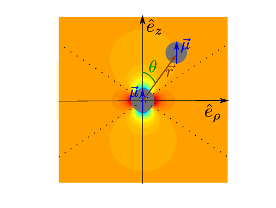
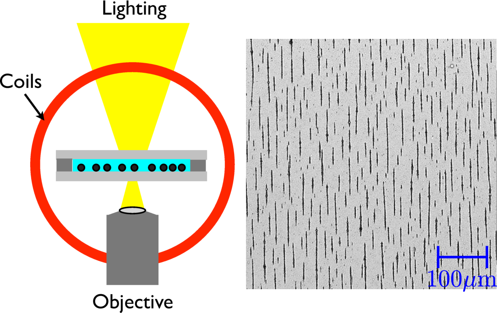
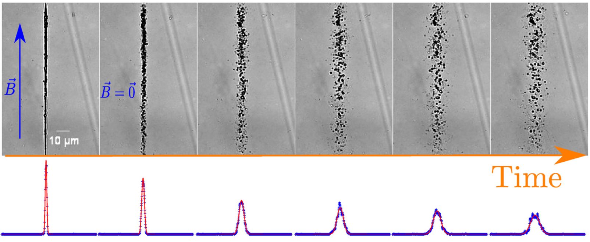
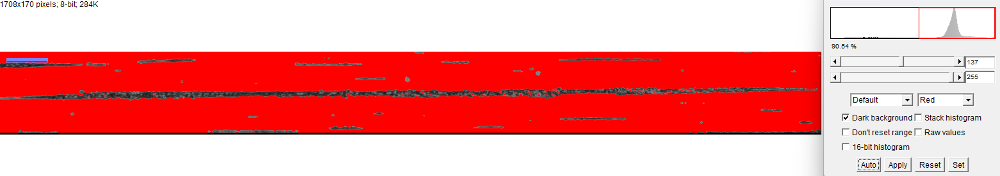
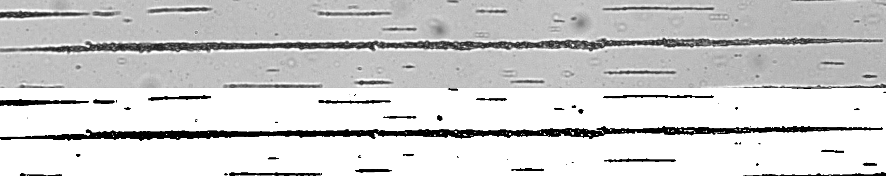
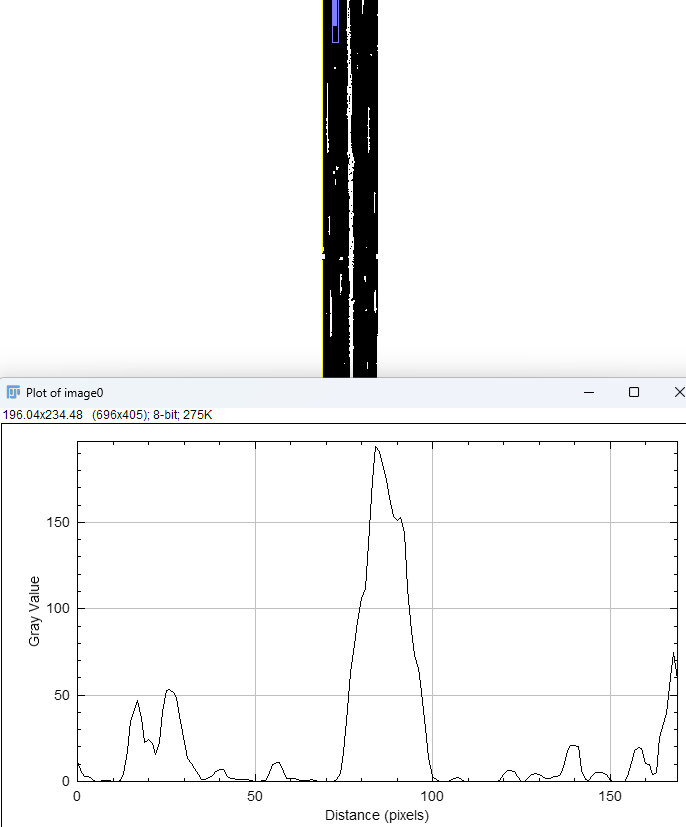
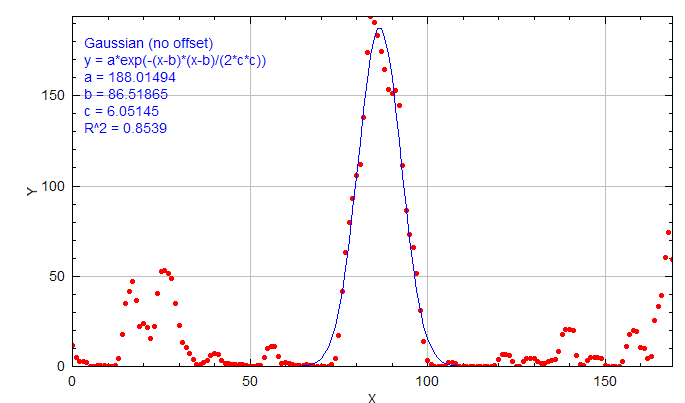

In this lecture, we will explore how to extract the diffusion coefficient from the collective motion of magnetic colloids. The lecture is based on the article below:

<video controls style="width:100%; max-width:700px;">
  <source src="part3_figs/Relating Brownian motion to diffusion with superparamagnetic col.mp4">
</video>

Video: Video abstract of [Relating Brownian motion to diffusion with superparamagnetic colloids](https://pubs.aip.org/aapt/ajp/article/85/4/265/1042575).
All Figures in this website are material initially prepared for the aforementioned manuscript.

# Learning objectives

At the end of this session you should be able to:

- identify an experimental observable that gives access to a diffusion coefficient;
- explain why a chain of superparamagnetic colloids constitutes an excellent initial condition for a diffusion experiment;
- transform microscopy images into concentration profiles;
- fit Gaussian distributions to experimental data;
- measure the evolution of the width of a diffusing particle cloud;
- extract a diffusion coefficient from microscopy images.

# Part I – Theory Reminder and Experimental Design

## Brownian motion versus diffusion

Previous lectures introduced Brownian motion and diffusion.

At the microscopic level, particles execute random trajectories due to collisions with solvent molecules.

At the macroscopic level, this random motion generates the diffusion equation

$$
\frac{\partial \rho}{\partial t}
=
D
\frac{\partial^2 \rho}{\partial x^2}.
$$

Rather than following individual trajectories, we shall work with the concentration field

$$
\rho(x,t).
$$

The practical question for today is therefore:

> How can we determine the diffusion coefficient experimentally?

## What observable should we measure?

For a localized initial condition,

$$
\rho(x,0)\approx \delta(x),
$$

the diffusion equation predicts a Gaussian profile

$$
\rho(x,t)
=
\frac{N}{\sqrt{4\pi Dt}}
\exp
\left(
-\frac{x^2}{4Dt}
\right).
$$

Instead of focusing on the profile itself, we characterize it using its Full Width at Half Maximum (FWHM).

For a Gaussian distribution,

$$
W
=
4\sqrt{\ln(2)\,Dt}.
$$

Therefore

$$
W^2
=
16 \ln(2)\,Dt.
$$

The diffusion coefficient can be obtained directly from the growth of the profile width.

::: {.callout-note}
Key idea:

Measure the width of the particle cloud as a function of time.

No particle tracking is required.
:::

# Creating a Localized Initial Condition

## Experimental challenge

The diffusion equation assumes an initially localized particle distribution.

How can we create such a state experimentally?

## Superparamagnetic colloids

The system used in this experiment consists of superparamagnetic colloidal particles suspended in water.

When an external magnetic field is applied:

- particles acquire induced dipole moments;
- dipoles align with the field;
- particles attract each other along the field direction;
- linear chains form spontaneously.


{#fig-MagneticInteractions}

{#fig-SetUp}


The chain provides an experimental realization of an initially narrow concentration profile.

## Switching on diffusion

The magnetic field is suddenly removed.

The induced magnetic dipoles disappear.

The chains become unstable and particles diffuse away from their initial positions.


{#fig-DiffChain}

The experiment therefore directly reproduces the localized initial condition discussed in diffusion theory.

# From Images to Density Profiles

The microscope does not measure density.

It provides images.

To connect experiment and theory we must transform images into concentration profiles.

The analysis consists of four steps:

1. Thresholding.
2. Binarization.
3. Profile extraction.
4. Gaussian fitting.

## Step 1: Thresholding

Particles appear darker than the background.

We choose a threshold intensity.

Pixels are classified as either:

- particle;
- background.

{#fig-thresh}

## Step 2: Binarization

After thresholding,

$$
I(x,y)
=
\begin{cases}
1 & \text{particle}\\
0 & \text{background}.
\end{cases}
$$

The resulting binary image contains only the information needed for particle detection.

{#fig-bin}

## Step 3: Averaging

Since the chain is approximately vertical, we average over the vertical direction:

$$
\rho(x)
=
\frac1{N_y}
\sum_y I(x,y).
$$

This produces a one-dimensional intensity profile, proportional to the concentration profile.

{#fig-Inten}

## Step 4: Gaussian fitting

Diffusion predicts a Gaussian profile.

We therefore fit

$$
\rho(x)
=
A
\exp
\left[
-\frac{(x-x_0)^2}
{2\sigma^2}
\right].
$$

{#fig-fitGauss}

The fitted parameter $\sigma$ provides the profile width. The corresponding FWHM is
$$
W
=
2\sqrt{2\ln 2}\,\sigma.
$$

Therefore, as $\sigma=\sqrt{2Dt}$, $W$ whould evolve as

$$
W
=
4\sqrt{\ln(2)\,Dt}.
$$

At this point we have all the ingredients required to measure a diffusion coefficient by analyzing the time evolution of $W$.


# Part II – Practical: Measuring a Diffusion Coefficient from a Sequence of Microscopy Images

In this practical session, we will analyse a sequence of images showing the diffusion of a colloidal chain after removal of an external magnetic field.

Rather than carrying out the analysis manually, we will use a Python workflow inspired by the code provided in the accompanying notebook.

The objective is to understand each step of the analysis, visualize the intermediate results, and identify how the diffusion coefficient emerges from the image sequence.

## Learning objectives

At the end of this practical you should be able to:

- load and display microscopy images in Python;
- perform image thresholding;
- visualize binary images;
- extract concentration profiles;
- fit Gaussian functions to experimental data;
- determine the width of a diffusing particle cloud;
- obtain a diffusion coefficient from experimental measurements.

# 1. Loading the image sequence

**Data folder:** [Download the images of diffusing chain](https://uob-my.sharepoint.com/:f:/g/personal/ln25672_bristol_ac_uk/IgCmyFGM6jKiTLlppz-P9CyZAfrjL7sD8A6BGo1aKYhCpvo?e=ejerf6)

Those pictures were taken at a frame rate of 1 frame per second, and that the resolution is of 5.4 pixel per micron. The magnetic field is removed at teh time the 10th image is taken.

The images are named

```text
image0.jpg
image1.jpg
...
image610.jpg
```

The first task is simply to inspect the data. Create a python script in Noteable or spyder, and use the following commands:

```python
from skimage.io import imread
import matplotlib.pyplot as plt

image = imread("image10.jpg")

plt.figure(figsize=(6,6))
plt.imshow(image, cmap="gray")
plt.title("Raw image")
plt.axis("off")
plt.show()
```

## Discussion

Observe the raw image carefully.

Questions:

- Can you clearly identify individual particles?
- Is the chain approximately vertical?
- Would it be possible to measure its width directly by eye?

Repeat the procedure for several times in the experiment:

```python
for frame in range(10,50,10):
    image = imread(f"image{frame}.jpg")

    plt.figure(figsize=(5,5))
    plt.imshow(image, cmap="gray")
    plt.title(f"Frame {frame}")
    plt.axis("off")
    plt.show()
```

### Question

How does the appearance of the chain evolve with time?

# 2. Understanding the Thresholding Step

The analysis begins by separating particles from the background.

The notebook uses Otsu thresholding.

For a single image:

```python
from skimage.filters import threshold_otsu
import numpy as np

image = imread("image10.jpg")

if image.ndim == 3:
    image = np.mean(image, axis=2)

image = np.max(image) - image

threshold = threshold_otsu(image)

binary = image > threshold
```

Display both images side-by-side:

```python
fig, ax = plt.subplots(1,2,figsize=(10,4))

ax[0].imshow(image,cmap="gray")
ax[0].set_title("Original")

ax[1].imshow(binary,cmap="gray")
ax[1].set_title("Binary image")

for a in ax:
    a.axis("off")

plt.show()
```

## Discussion

Verify that:

- particles are identified correctly;
- most of the background has been removed;
- the chain remains clearly visible.

What would happen if the threshold were:

- too low?
- too high?

# 3. From a Binary Image to a Concentration Profile

The binary image still contains two-dimensional information.

The diffusion process occurs primarily in the horizontal direction.

To obtain a concentration profile we average along the vertical direction.

The notebook performs

```python
profile = binary.mean(axis=0)
```

Let us visualize this profile.

```python
import numpy as np

x = np.arange(len(profile))

plt.figure(figsize=(6,4))
plt.plot(x, profile, "k-")
plt.xlabel("Pixel index")
plt.ylabel("Average occupation")
plt.title("Concentration profile")
plt.show()
```

## Discussion

Compare the profile with the original chain.

Questions:

- Where is the centre of the chain?
- Is the profile symmetric?
- Does the profile resemble a Gaussian function?

# 4. Visualizing Diffusion

Repeat the profile extraction for several times.

```python
frames = range(10,50,10)

plt.figure(figsize=(7,5))

for frame in frames:

    image = imread(f"image{frame}.jpg")

    if image.ndim == 3:
        image = np.mean(image, axis=2)

    image = np.max(image)-image

    threshold = threshold_otsu(image)

    binary = image > threshold

    profile = binary.mean(axis=0)

    x = np.arange(len(profile))

    plt.plot(x, profile, label=f"t = {frame}")

plt.xlabel("Pixel index")
plt.ylabel("Average occupation")
plt.legend()
plt.show()
```

### Observation

You should observe:

- a decreasing peak height;
- an increasing width;
- an approximately Gaussian shape throughout the experiment.

This is precisely what diffusion theory predicts.

# 5. Gaussian Fits

To quantify the width of the profile we fit a Gaussian function

$$
\rho(x)
=
A
\exp
\left[
-\frac{(x-x_0)^2}{2\sigma^2}
\right].
$$

In the notebook, use:

```python
import numpy as np
import matplotlib.pyplot as plt
from scipy.optimize import curve_fit

def gaussian(x, a, b, c):
    return a * np.exp(-((x - b) / c)**2)

# Fit the Gaussian
popt, pcov = curve_fit(
    gaussian,
    x,
    profile,
    p0=[np.max(profile), x[np.argmax(profile)], 10]
)
```

After fitting a profile, visualize the result.

```python
plt.figure(figsize=(6,4))

plt.plot(x, profile, "ko", label="Data")
plt.plot(x, gaussian(x,*popt), "r-", lw=2,
         label="Gaussian fit")

plt.xlabel("Pixel index")
plt.ylabel("Occupation")
plt.legend()

plt.show()
```

## Discussion

Questions:

- Why is the Gaussian shape expected?
- At what times does the fit appear most reliable?
- Where are the largest deviations observed?

# 6. Determining the Width

The fitting parameter controlling the width is converted into a Full Width at Half Maximum (FWHM).

With the notebook, compute

```python
pxlperum=5.4
c = popt[2]
FWHM = c*2*np.sqrt(np.log(2))/pxlperum
print(FWHM)
```

after converting pixels into micrometres.

Use the following script to automatically extract one width for every image of the sequence.

To inspect the results:

```python
fps=1
step=10
frames=range(10,600,10)
times=np.array(list(frames)) / fps
count=0
widths=[]
for frame in frames:

    image = imread(f"image{frame}.jpg")

    if image.ndim == 3:
        image = np.mean(image, axis=2)

    image = np.max(image)-image

    threshold = threshold_otsu(image)

    binary = image > threshold

    profile = binary.mean(axis=0)

    x = np.arange(len(profile))

    popt, pcov = curve_fit(
        gaussian,
        x,
        profile,
        p0=[np.max(profile), x[np.argmax(profile)], 10]
    )
    c=popt[2]
    FWHM = c * 2 * np.sqrt(np.log(2))/pxlperum
    widths.append(FWHM)
    count=count+1

plt.figure(figsize=(6,4))

plt.plot(times,widths,
             "ko",
             label="Measurements")

def theory(t, D, t0):
    return 4*np.sqrt(np.log(2)*D*(t + t0))

popt_theory, pcov_theory = curve_fit(
    theory,
    times,
    widths,
    p0=[1.0,0.0],   # initial guess for D and t0
    bounds=([0, -np.min(times)], [np.inf, np.inf]) #ensures no negative values are tried
)

D, t0 = popt_theory

xfit = np.linspace(np.min(times), np.max(times), 500)
yfit = theory(xfit, D, t0)


plt.plot(xfit,yfit,"r-",lw=2,
         label="Theory")

plt.xlabel("Time (s)")
plt.ylabel("Width (µm)")
plt.legend()

plt.show()

print("D  =", D, " µm^2/s")
print("t0 =", t0," s")
```

## Discussion

Do the data appear:

- linear?
- square-root-like?
- exponential?

Compare your answer with the theoretical prediction

$$
W
=
4\sqrt{\ln(2)\,Dt}.
$$

# 7. Extracting the Diffusion Coefficient

The final step consists of fitting the theoretical width evolution.

The model used in the notebook is

$$
W
=
4\sqrt{\ln(2)\,D\,(t+t_0)}.
$$

where:

- $D$ is the diffusion coefficient;
- $t_0$ accounts for the finite initial width of the chain.

The parameter of interest is

```python
print("D  =", D, " µm^2/s")
```

which gives the experimental diffusion coefficient.

# 8. Interpreting the Result

Compare the measured diffusion coefficient with your neighbours.

Discuss possible differences arising from:

- image thresholding;
- image quality;
- finite image resolution;
- fitting uncertainties;
- deviations from an ideal Gaussian distribution.

# Practical Summary

In this exercise we reproduced the workflow used in the article:

1. Load microscopy images.
2. Threshold and binarize the images.
3. Extract concentration profiles.
4. Fit Gaussian distributions.
5. Measure the profile width.
6. Follow the broadening of the chain.
7. Extract the diffusion coefficient.

This experiment illustrates perfectly how a macroscopic transport coefficient emerges from the microscopic Brownian motion of individual particles.