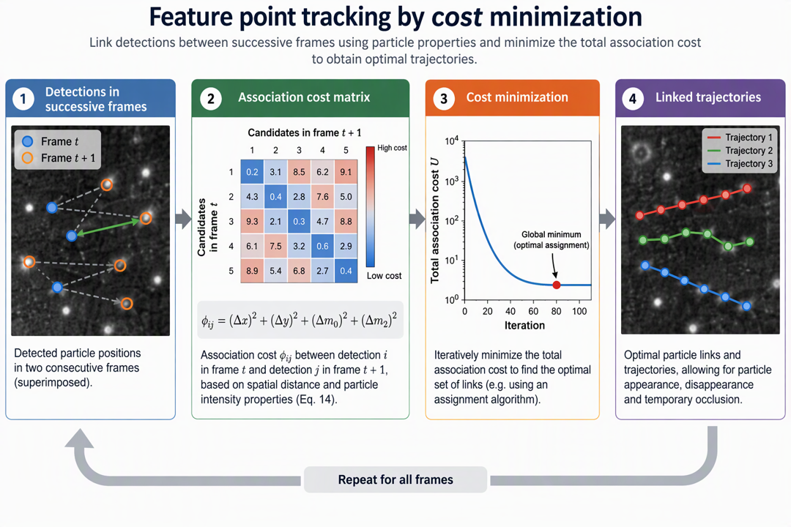
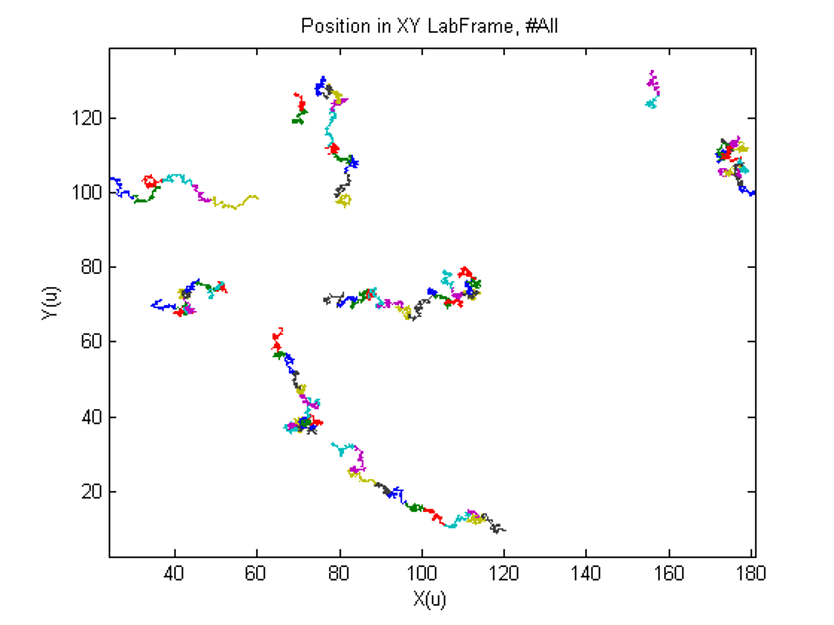
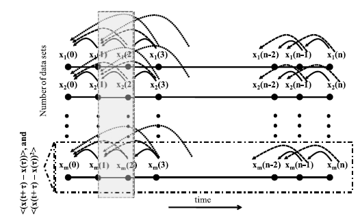
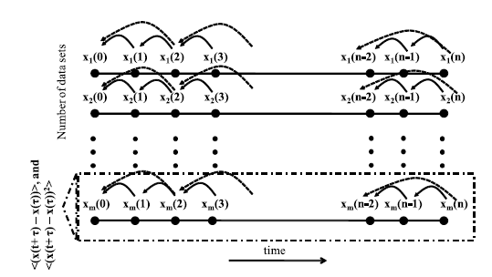

## Introduction

In the previous practical, diffusion coefficients were determined from the spreading of an entire particle concentration profile. In this activity, we will extract the same physical quantity from a completely different type of measurement: the trajectories of individual particles.

The starting point is a microscopy movie containing many diffusing particles. Rather than analysing the evolution of a particle cloud, we will follow the motion of individual particles through time and analyse their displacements statistically. This approach forms the basis of modern single-particle tracking experiments.
### From microscopy images to trajectories

Before any quantitative analysis can be performed, the particles must first be detected in each image. This is typically achieved through image-processing procedures such as thresholding and binarization, similar to the ones we described during last session, which identify the position of individual particles in every frame. The detailed method is highly specific to the experimental setup, and we will not explore this deeply in this lecture.


Once particles have been detected, the next challenge is to associate detections between successive frames. Tracking algorithms compare possible particle matches and select the most probable trajectory by minimizing an appropriate cost function. Repeating this procedure throughout the image sequence produces a collection of particle trajectories. These algorithms are often taylored to the application, some taking into account the possibility for a particle to disappear, or for a new particle to appear, with constraints on the maximum object deformation or displacement between frames. In a numerical simulation, the trajectory is however often obtained as primary output, as each particle can be identified all along the computation.

{#fig-track}

After processing all frames (or computational time steps), the result is a list of particle trajectories:

$$
\mathbf r(t) = \bigl(x(t),y(t)\bigr),
$$

where the particle position is known at many successive times. These trajectories contain direct information about the microscopic random motion responsible for diffusion.

{#fig-traj}

### From trajectories to diffusion

To characterize diffusion, we analyse particle displacements over a lag time $\tau$:

$$
\Delta x(t,\tau)=x(t+\tau)-x(t),
$$

and similarly for the $y$ coordinate.

For purely random Brownian motion, the average displacement should vanish,

$$
\langle \Delta x \rangle = 0,
$$

while the mean-square displacement grows with time. In practice, experimental data may contain a small drift resulting from fluid flow, stage motion, or other systematic effects. Subtracting the average displacement allows us to separate random diffusive motion from directed motion.

### Computing the Mean-Square Displacement (MSD)

A powerful way to characterize diffusion is through the mean-square displacement (MSD). Because any time point can be chosen as the starting point of a displacement measurement, many displacement intervals can be extracted from a single trajectory. This greatly improves statistics.

{#fig-MSDover}

However, many of these displacement intervals overlap and therefore share common trajectory segments. As a result, they are not statistically independent and become auto-correlated. One possible solution is to use only non-overlapping intervals, sacrificing some statistics in exchange for greater statistical independence. We will compare both approaches later in this practical.

{#fig-MSDdecorr}

For a particle diffusing in $d$ dimensions, the MSD is expected to increase linearly with time according to

$$
\langle |\Delta \mathbf r(t)|^2 \rangle -
\langle \Delta \mathbf r(t) \rangle^2
=
2dDt,
$$

where $D$ is the diffusion coefficient. In our experiments, motion is tracked in two dimensions, so the theoretical prediction becomes

$$
MSD(t)=4Dt.
$$

By measuring the MSD and fitting its dependence on time, we will determine the diffusion coefficient directly from individual particle trajectories.

The objectives of this practical are therefore to:

1. Visualize particle trajectories.
2. Compute particle displacements.
3. Calculate mean-square displacements.
4. Determine diffusion coefficients from MSD analysis.
5. Compare different statistical estimators of the MSD.
6. Relate microscopic particle motion to macroscopic diffusion.


## Loading the trajectory data

Their [example trajectory files](https://uob-my.sharepoint.com/:f:/g/personal/ln25672_bristol_ac_uk/IgC5zY6Yzr-nT4CTwytEhXGUAVNq0V0WKAVaKcS5fI-nJNU?e=5GV9zk) describes 2D projection of elliptical particles and contains

```text
time   x   y   theta "Major Axis" "Minor Axis"
```

Time is provided in seconds and the angle `theta` is in radians. All distances and lengths are in micrometers.

depending on the experiment. Download the data and save it somewhere to access with Spyder or Noteable.

Load the data (choose a trajectory number, TrajNum, different from that of your neighbours):

```python
import pandas as pd

TrajNum = 25

traj = pd.read_csv(
    f"data{TrajNum}.txt",
    sep=r"\s+",
    header=None,
    names=[
        "time",
        "x",
        "y",
        "theta",
        "MajorAxis",
        "MinorAxis"
    ]
)

traj.head()
```

Inspect the first few lines of the dataset.

Questions:

- How many frames are available?
- Which coordinates are recorded?
- Is time stored in seconds or frame numbers?


## Visualizing trajectories

Before calculating any quantity, always inspect the raw trajectories.

```python
import matplotlib.pyplot as plt

plt.figure(figsize=(6,6))

plt.plot(traj["x"], traj["y"],lw=1)
plt.ylabel("y")
plt.xlabel("x")
plt.axis("equal")
```

### Discussion

Observe the trajectory.

- Does it appear isotropic?
- Is there any obvious drift?
- Does the particle explore the entire field of view?


## Position versus time

The next step is to visualize the coordinates as functions of time.

```python
fig, ax = plt.subplots(
    2,
    1,
    figsize=(8,5),
    sharex=True
)

ax[0].plot(
    traj["time"],
    traj["x"]
)

ax[0].set_ylabel(r"x ($\mu$m)")

ax[1].plot(
    traj["time"],
    traj["y"]
)

ax[1].set_ylabel(r"y ($\mu$m)")
ax[1].set_xlabel("Time (s)")

plt.show()
```

### Discussion

What information is easier to identify here than in the trajectory plot?

In particular:

- Are there sudden jumps?
- Are some directions favoured?
- Does the particle remain centred around a fixed position?


## Computing displacements

Diffusion is characterised by displacements over a given lag time.

Choose a lag:

```python
tau = 10
```

and compute

```python
import numpy as np

x = traj["x"].values
y = traj["y"].values

dx = x[tau:] - x[:-tau]
dy = y[tau:] - y[:-tau]
```

These quantities represent particle displacements over a time interval corresponding to `tau` frames.


## Visualizing displacement distributions

Plot the distribution of horizontal displacements.

```python
plt.figure(figsize=(6,4))

plt.hist(
    dx,
    bins=40,
    density=True
)

plt.xlabel(r"$\Delta$ x ($\mu$ m)")
plt.ylabel("Probability density")

plt.show()
```

Repeat for

```python
dy
```

### Discussion

Diffusion predicts approximately Gaussian displacement distributions.

Questions:

- Does the histogram resemble a Gaussian?
- Are the positive and negative displacements equally probable?
- Does the distribution appear symmetric?


## Calculating the Mean-Square Displacement

The central quantity of this practical is the corrected MSD:

$$
MSD(\tau)
=
\left<
|\mathbf r(t+\tau)-\mathbf r(t)|^2
\right>-\left<
\mathbf r(t+\tau)-\mathbf r(t)
\right>^2.
$$

Define a function to compute it.

```python
import numpy as np

def MSD(x, y, maxlag):

    msd = []

    for lag in range(1, maxlag):

        dx = x[lag:] - x[:-lag]
        dy = y[lag:] - y[:-lag]

        msd.append(
            np.mean(dx**2 + dy**2)-np.mean(dx)**2-np.mean(dy)**2
        )

    return np.array(msd)
```

Compute the MSD:

```python
msd = MSD(
    x,
    y,
    maxlag=200
)
```


## Visualizing the MSD

```python
lags = np.arange(1, len(msd) + 1)
#in physical units
dt = np.mean(
    np.diff(traj["time"])
)

plt.figure(figsize=(6,4))

plt.plot(
    lags*dt,
    msd,
    "ko"
)

plt.xlabel("lag time (s)")
plt.ylabel(r"MSD ($\mu m^2$)")

plt.show()
```

### Discussion

What is the overall trend?

Diffusion predicts:

$$
MSD = 4Dt
$$

for two-dimensional motion.

Do the data appear compatible with a linear dependence?


## Determining the diffusion coefficient

Fit the initial part of the MSD.

```python
from scipy.stats import linregress

MaxLagFit=50

fit = linregress(
    lags[:MaxLagFit]*dt,
    msd[:MaxLagFit]
)

D = fit.slope / 4

print("Diffusion coefficient =", D)
```

Visualize the fit.

```python
plt.figure(figsize=(6,4))

plt.plot(
    lags*dt,
    msd,
    "ko",
    label="MSD"
)

plt.plot(
    lags[:MaxLagFit]*dt,
    fit.intercept + fit.slope * lags[:MaxLagFit]*dt,
    "r-",
    lw=2,
    label="Linear fit"
)

plt.xlabel("Lag time (s)")
plt.ylabel(r"MSD ($\mu m^2$)")
plt.legend()

plt.show()
```

### Discussion

Why might it be preferable to fit only short lag times?


## Log-log representation

A useful diagnostic tool is a log-log plot.

If we assume that the relationship is indeed linear, we should have

```python
#let's now use this shortcut
tau=lags*dt


log_t = np.log10(
    tau[:MaxLagFit]
)

log_msd = np.log10(
    msd[:MaxLagFit]
)

intercept = np.mean(
    log_msd - log_t
)

D = 10**intercept / 4

print(f"D = {D:.3f} µm²/s")

plt.loglog(
    tau,
    msd,
    "ko"
)

plt.loglog(
    tau[:MaxLagFit],
    10**(intercept + log_t),
    "r-",
    lw=2,
    label=f"α = 1, D = {D:.2f} µm²/s"
)
plt.xlabel("Lag time (s)")
plt.ylabel(r"MSD ($\mu m^2$)")
plt.show()
```


But we can also let the slope be freely adjusted:
```python
# Let's use this shortcut
tau = lags * dt

log_t = np.log10(
    tau[:MaxLagFit]
)

log_msd = np.log10(
    msd[:MaxLagFit]
)

fit = linregress(
    log_t,
    log_msd
)

alpha = fit.slope

D = (
    10**fit.intercept
) / 4

print(
    f"alpha = {alpha:.3f}"
)

print(
    f"D = {D:.3f} (µm²/s^α)"
)

plt.figure(figsize=(6,4))

plt.loglog(
    tau,
    msd,
    "ko",
    label="MSD"
)

plt.loglog(
    tau[:MaxLagFit],
    10**(
        fit.intercept
        +
        fit.slope * np.log10(tau[:MaxLagFit])
    ),
    "r-",
    lw=2,
    label=(
        f"Fit: α = {alpha:.2f}, "
        f"D = {D:.2f} µm²/s^α"
    )
)

plt.xlabel("Lag time (s)")
plt.ylabel(r"MSD ($\mu m^2$)")
plt.legend()

plt.show()
```

For a power law,

$$
MSD \propto t^\alpha,
$$

the exponent can be interpreted as:

- $\alpha = 1$: normal diffusion;
- $\alpha < 1$: subdiffusion;
- $\alpha > 1$: superdiffusion.

### Discussion

Does the experimental curve appear compatible with normal diffusion?

## Improving MSD Statistics

So far, our MSD calculation has used every possible displacement separated by a given lag time,

$$
\Delta x = x(t+\tau)-x(t).
$$

This approach maximizes the number of measurements contributing to the MSD, but many of these measurements are not statistically independent because they share data points.

For example, for a lag of 10 frames, the displacements

$$
x_{20}-x_{10}
$$

and

$$
x_{21}-x_{11}
$$

overlap strongly, since most of the trajectory segment is shared between them.

As the lag time increases, this overlap becomes increasingly significant.

### MSD using overlapping intervals

Our previous implementation used all possible displacements for each lag:

```python
def MSD_overlap(x, y, maxlag):

    msd = []

    for lag in range(1, maxlag):

        dx = x[lag:] - x[:-lag]
        dy = y[lag:] - y[:-lag]

        msd.append(
            np.mean(dx**2 + dy**2)-np.mean(dx)**2-np.mean(dy)**2
        )

    return np.array(msd)
```

This method uses the largest possible number of measurements and therefore often produces a smooth MSD curve.

### MSD using non-overlapping intervals

To reduce correlations between measurements, we can instead use only independent trajectory segments.

For each lag time, we select displacements separated by at least that lag:

```python
def MSD_nonoverlap(x, y, maxlag):

    msd = []

    for lag in range(1, maxlag):

        nblocks = len(x) // lag

        if nblocks < 2:
            msd.append(np.nan)
            continue

        dx = (
            x[lag:nblocks*lag:lag]
            - x[:(nblocks-1)*lag:lag]
        )

        dy = (
            y[lag:nblocks*lag:lag]
            - y[:(nblocks-1)*lag:lag]
        )

        msd.append(
            np.mean(dx**2 + dy**2)-np.mean(dx)**2-np.mean(dy)**2
        )

    return np.array(msd)
```

Calculate both MSD estimates:

```python
msd_overlap = MSD_overlap(
    x,
    y,
    maxlag=200
)

msd_nonoverlap = MSD_nonoverlap(
    x,
    y,
    maxlag=200
)
```

Compare the results:

```python
lags = np.arange(
    1,
    len(msd_overlap)+1
)

plt.figure(figsize=(6,4))

plt.plot(
    lags*dt,
    msd_overlap,
    label="Overlapping MSD"
)

plt.plot(
    lags*dt,
    msd_nonoverlap,
    label="Non-overlapping MSD"
)

plt.xlabel("tau (s)")
plt.ylabel("MSD (µm²)")
plt.legend()

# Linear fits


# Overlapping MSD fit
fit_overlap = linregress(
    tau[:MaxLagFit],
    msd_overlap[:MaxLagFit]
)

D_overlap = fit_overlap.slope / 4

# Non-overlapping MSD fit
valid = np.isfinite(msd_nonoverlap)

fit_nonoverlap = linregress(
    tau[:MaxLagFit][valid[:MaxLagFit]],
    msd_nonoverlap[:MaxLagFit][valid[:MaxLagFit]]
)

D_nonoverlap = fit_nonoverlap.slope / 4


plt.plot(
    tau[:MaxLagFit],
    fit_overlap.intercept
    + fit_overlap.slope * tau[:MaxLagFit],
    'r--',
    lw=2,
    label=f"Overlap fit (slope={fit_overlap.slope:.4f})"
)

plt.plot(
    tau[:MaxLagFit],
    fit_nonoverlap.intercept
    + fit_nonoverlap.slope * tau[:MaxLagFit],
    'k--',
    lw=2,
    label=f"Non-overlap fit (slope={fit_nonoverlap.slope:.4f})"
)

plt.show()

print(f"Overlap MSD:")
print(f"  slope = {fit_overlap.slope:.6f} µm²/s")
print(f"  D = {D_overlap:.6f} µm²/s")

print()

print(f"Non-overlap MSD:")
print(f"  slope = {fit_nonoverlap.slope:.6f} µm²/s")
print(f"  D = {D_nonoverlap:.6f} µm²/s")
```

### Questions

1. Which curve appears noisier?
2. Which method uses the largest number of displacement measurements?
3. Which method provides the most statistically independent measurements?
4. Why do the differences become larger at long lag times?

Although the overlapping MSD typically looks smoother, many of its measurements are correlated. The non-overlapping MSD uses fewer data points but provides more statistically independent estimates.

In experimental studies it is common to compare both approaches to assess the influence of temporal correlations.

---

## Time Averaging and Ensemble Averaging

There are two fundamentally different ways to improve the statistical quality of diffusion measurements:

1. **Time averaging**: using longer trajectories.
2. **Ensemble averaging**: combining measurements from multiple particles.

So far, each of us has analysed only one particle trajectory. However, the files `dataXX.txt` correspond to many different particles diffusing under the same experimental conditions.

By analysing several particles and averaging their results, we can obtain more reliable estimates of the MSD and diffusion coefficient.

---

## Ensemble-Averaged MSD

### Loading several trajectories

Select a set of trajectories:

```python
trajectory_numbers = range(1,92)
```

Calculate the MSD for each particle:

```python
all_msd = []

for num in trajectory_numbers:

    traj = pd.read_csv(
        f"data{num}.txt",
        sep=r"\s+",
        header=None,
        names=[
            "time",
            "x",
            "y",
            "theta",
            "MajorAxis",
            "MinorAxis"
        ]
    )

    msd = MSD_nonoverlap(
        traj["x"].values,
        traj["y"].values,
        maxlag=200
    )

    all_msd.append(msd)

all_msd = np.array(all_msd)
```

Calculate the ensemble average:

```python
mean_msd = np.nanmean(
    all_msd,
    axis=0
)

std_msd = np.nanstd(
    all_msd,
    axis=0
)
```

Visualize the result:

```python
lags = np.arange(
    1,
    len(mean_msd)+1
)

plt.figure(figsize=(6,4))

# Error bars in grey
plt.errorbar(
    lags,
    mean_msd,
    yerr=std_msd,
    fmt="none",
    ecolor="0.6",
    capsize=2,
    zorder=1
)

# Best estimates on top
plt.plot(
    lags,
    mean_msd,
    "ro",
    ms=5,
    label="Mean MSD",
    zorder=2
)

plt.xlabel("Lag (frames)")
plt.ylabel("MSD (µm²)")
plt.legend()

plt.show()
```

### Questions

1. How does the ensemble-averaged MSD compare with that of a single particle?
2. Which curve appears less noisy? What is the origin of the jumps in the ensemble average?
3. How does increasing the number of particles affect the uncertainty?

The uncertainty on the ensemble average decreases approximately as

$$
\sigma_{\mathrm{mean}}
=
\frac{\sigma}{\sqrt{N}}
$$

where $N$ is the number of independent particle trajectories.

This is one of the main reasons why diffusion experiments typically analyse many particles rather than a single long trajectory.

---

## Determining the Diffusion Law

For normal diffusion,

$$
MSD(t)=4Dt.
$$

More generally, anomalous diffusion is described by

$$
MSD(t)=4Dt^{\alpha},
$$

where:

- $D$ is the diffusion coefficient,
- $\alpha=1$ corresponds to normal diffusion,
- $\alpha<1$ corresponds to subdiffusion,
- $\alpha>1$ corresponds to superdiffusion.

Taking the logarithm of both sides gives

$$
\log(MSD)
=
\log(4D)
+
\alpha\log(t).
$$

Therefore:

- the slope of a log-log plot gives $\alpha$,
- the intercept gives $\log(4D)$.

---

## Converting Lag Number into Physical Time

The previous blocks of code silently converted the lag values from numbers of frames to time intervals.

For a constant time frame, this can be done by determining the time interval between two frames:

```python
dt = np.mean(
    np.diff(traj["time"])
)
```

Convert lag numbers into physical lag times simply reads:

```python
tau = lags * dt
```

The lag times are now expressed in seconds.

---

## Selecting a Suitable Fitting Range

Very short lag times are often affected by localization noise.

Very long lag times contain relatively few independent measurements and therefore have larger uncertainty.

Inspect your MSD curve and choose an appropriate fitting region.

For example:

```python
fit_mask = (
    (tau >= 0.0)
    &
    (tau <= 2.0)
)
```

You may need to adjust these limits depending on your data.

---

## Fitting the MSD in Log-Log Space

Perform a linear regression on the logarithms, once for normal diffusion ($\alpha=1$) and once taking into account possible anomaly:

```python
# Unconstrained fit
log_t = np.log10(
    tau[fit_mask]
)

log_msd = np.log10(
    mean_msd[fit_mask]
)

fit = linregress(
    log_t,
    log_msd
)

alpha = fit.slope

D = (
    10**fit.intercept
) / 4

alpha_err = fit.stderr

D_err = (
    D
    * np.log(10)
    * fit.intercept_stderr
)

print(
    f"α = {alpha:.3f} ± {alpha_err:.3f}"
)

print(
    f"D = {D:.3f} ± {D_err:.3f} µm²/s^α"
)

# --------------------------------------------------
# Constrained fit: alpha = 1 (normal diffusion)
# --------------------------------------------------

intercept_fixed = np.mean(
    log_msd - log_t
)

D_normal = (
    10**intercept_fixed
) / 4


sigma_intercept = np.std(
    log_msd - log_t,
    ddof=1
) / np.sqrt(
    len(log_msd)
)

D_normal_err = (
    D_normal
    * np.log(10)
    * sigma_intercept
)

print(
    f"D (assuming α=1) = {D_normal:.3f} ± {D_normal_err:.3f} µm²/s"
)
```

---

## Visualizing the Fit

```python
plt.figure(figsize=(6,4))

plt.loglog(
    tau[fit_mask],
    mean_msd[fit_mask],
    "ko",
    ms=4,
    label="Mean MSD"
)

# Free alpha fit
plt.loglog(
    tau[fit_mask],
    10**(
        fit.intercept
        + fit.slope * log_t
    ),
    "r-",
    lw=2,
    label=(
        f"Fit: α = {alpha:.3f} ± {alpha_err:.3f}, "
        f"D = {D:.3f} ± {D_err:.3f} µm²/s^α"
    )
)

# Fixed alpha=1 fit
plt.loglog(
    tau[fit_mask],
    10**(
        intercept_fixed
        + log_t
    ),
    "b--",
    lw=2,
    label=(
        f"α = 1 fixed, "
        f"D = {D_normal:.3f} ± {D_normal_err:.3f} µm²/s"
    )
)

plt.xlabel("τ (s)")
plt.ylabel("MSD (µm²)")
plt.legend()
plt.tight_layout()
plt.show()

```

---

## Discussion

Interpret the fitted value of $\alpha$:

- $\alpha \approx 1$: normal diffusion
- $\alpha < 1$: subdiffusion
- $\alpha > 1$: superdiffusion

Compare your fitted diffusion coefficient with:

1. the value obtained previously from a single trajectory,
2. the value obtained using the concentration-profile method.

### Questions

1. Which diffusion coefficient appears most reliable?
2. How does ensemble averaging change the uncertainty?
3. What are the advantages and disadvantages of overlapping and non-overlapping MSD calculations?
4. What evidence do you find for normal or anomalous diffusion?

---

## Key Conclusions

The quality of a diffusion measurement depends strongly on the number of statistically independent displacement measurements available.

The reliability of the analysis can be improved by:

- analysing longer trajectories,
- using non-overlapping displacements,
- averaging over multiple particles,
- fitting the MSD only over an appropriate range of lag times.

These ideas form the basis of modern single-particle tracking experiments and allow accurate determination of both diffusion coefficients and anomalous diffusion exponents.


## Comparison with the Previous Practical

You have now measured a diffusion coefficient using two entirely different methods:

### Density-field method

- Use all particles simultaneously.
- Measure the width of a concentration profile.
- Fit the broadening of the profile.

### Trajectory method

- Follow individual particles.
- Calculate displacements.
- Compute the MSD.

Both methods should produce consistent values of the diffusion coefficient.

This agreement provides a powerful demonstration that the continuum diffusion equation emerges directly from the random motion of individual particles.

# Practical Summary

In this activity you have

1. Visualized Brownian trajectories.
2. Calculated particle displacements.
3. Measured displacement distributions.
4. Computed mean-square displacements.
5. Extracted a diffusion coefficient.
6. Connected single-particle dynamics to macroscopic diffusion.

Together with the analysis of diffusing chains, this provides two complementary experimental approaches to the same physical phenomenon.