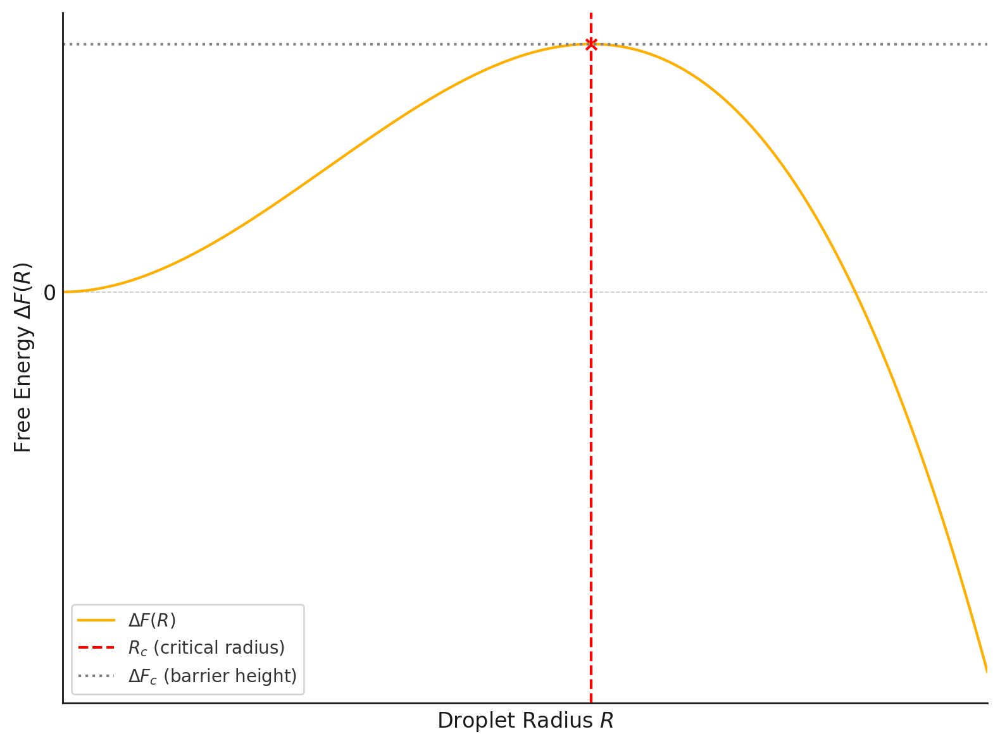
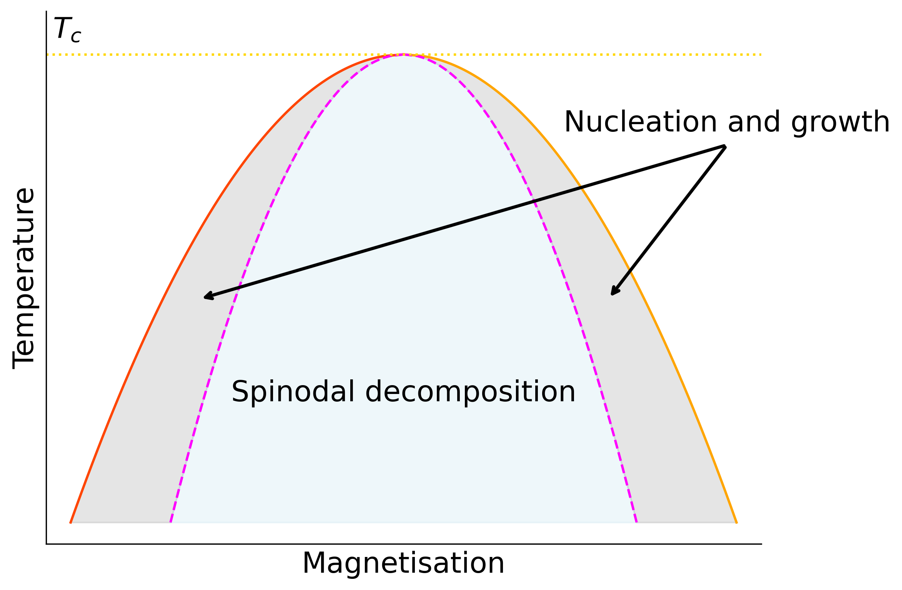
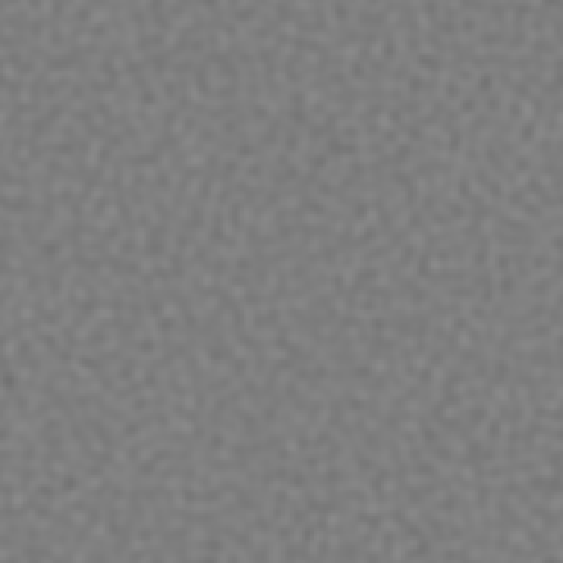
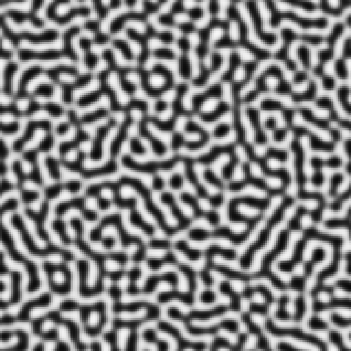
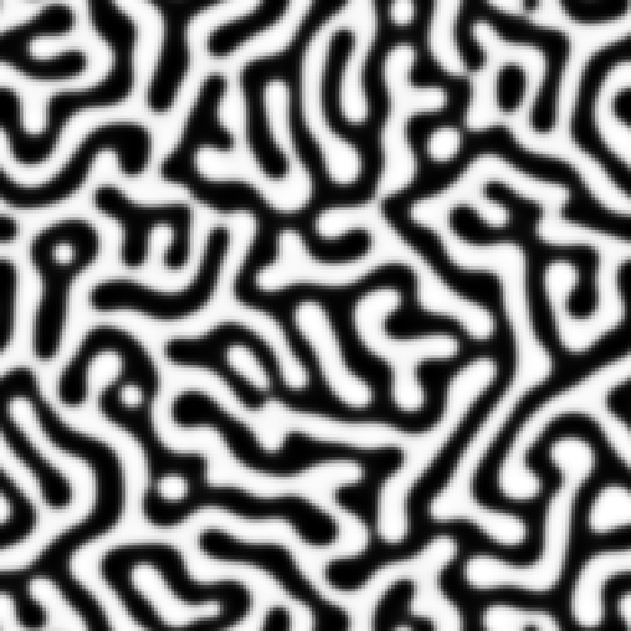

# Dynamics of first order phase transitions: nucleation, growth and spinodal decomposition

## Introduction to nucleation

In previous discussions, we considered first-order phase transitions but deferred a detailed analysis of the *dynamical* mechanism by which a system evolves from one phase to another. We now address this question explicitly.

Consider again the Ising model at a temperature $T < T_c$, where the system is initially prepared in the majority spin-up phase at zero external field, $H = 0$. At $H=0$ the spin-up and spin-down phases coexist. We now apply a small negative external field $H < 0$, which lowers the free energy of the spin-down phase relative to the spin-up phase. The spin-down phase is therefore stable, while the spin-up phase is metastable.

It is useful at this point to identify the thermodynamic driving force for the transition. Let

$$
\Delta f = f_{\mathrm{meta}}-f_{\mathrm{stable}}>0
$$

be the bulk free-energy density difference between the metastable and stable phases. Converting a volume $V$ of metastable material into the stable phase lowers the bulk free energy by

$$
\Delta F_{\mathrm{bulk}}=-V\Delta f.
$$

For the Ising model, this free-energy difference is produced by the applied field. Close to coexistence,

$$
\Delta f \simeq 2m_0|H|,
$$

where $m_0$ is the magnitude of the spontaneous magnetisation. Thus the bulk driving force vanishes as $H\to0$, where the two phases coexist.

For a molecular system, the same driving force is often expressed in terms of a chemical-potential difference,

$$
\Delta\mu=\mu_{\mathrm{meta}}-\mu_{\mathrm{stable}}>0.
$$

The bulk free-energy gain for converting $N$ particles to the stable phase is then approximately

$$
\Delta F_{\mathrm{bulk}}\simeq-N\Delta\mu.
$$

Thus $\Delta f$ and $\Delta\mu$ are simply two ways of expressing the bulk thermodynamic driving force, per unit volume or per particle.

Despite the spin-down phase having the lower free energy, the system does not undergo an instantaneous transition. This delay is a consequence of the free-energy barrier associated with nucleating a region of the stable phase within the metastable one, as introduced in @sec-breaking. The transition proceeds via *nucleation* of local regions---or *droplets*---of the stable (spin-down) phase embedded in the metastable (spin-up) background. Once nucleated, sufficiently large droplets grow and can ultimately transform the system to the stable phase.

The nucleation of a droplet therefore involves a competition between two contributions to the free energy. There is a bulk free-energy gain, proportional to the volume of the droplet, because the droplet is in the stable phase. This is offset by an interfacial free-energy cost arising from the boundary between the two phases. For the Ising model, broken bonds contribute an energetic cost, while the fluctuating shape of the interface also gives an entropic contribution. Their combined effect is described by the *surface tension* $\sigma$.

The competition between the extensive bulk free-energy gain and the sub-extensive interfacial cost gives a free-energy barrier to droplet formation. Only fluctuations that produce a droplet larger than a critical size will grow; smaller droplets will shrink. This is the basis of *classical nucleation theory*.

## Classical Nucleation Theory: Homogeneous Nucleation {#sec-cnt}

We now consider **classical nucleation theory** (CNT) for *homogeneous nucleation*, in which the stable phase nucleates spontaneously in the bulk of the metastable phase, without the aid of impurities, defects or surfaces.

Consider a droplet of the stable (spin-down) phase of radius $R$ embedded in the metastable (spin-up) phase. The change in free energy $\Delta F(R)$ has two contributions:

1. **Bulk free-energy gain**: The stable phase has a lower bulk free-energy density than the metastable phase by $\Delta f>0$. Thus

   $$
   \Delta F_{\mathrm{bulk}}(R)=-\Delta f\,V_dR^d,
   $$

   where $V_dR^d$ is the volume of the droplet in $d$ dimensions. For the Ising model, $\Delta f\propto |H|$ close to coexistence. For a molecular system the same contribution can instead be expressed in terms of $\Delta\mu$.

2. **Interfacial free-energy cost**: The boundary between the two phases has area $S_dR^{d-1}$ and carries a free-energy cost proportional to the surface tension $\sigma$:

   $$
   \Delta F_{\mathrm{surface}}(R)=\sigma S_dR^{d-1},
   $$

   where $S_d$ is a geometrical factor (e.g. $S_2=2\pi$ in 2D and $S_3=4\pi$ in 3D).

The total free-energy change is therefore

$$
\Delta F(R)=\sigma S_dR^{d-1}-\Delta f\,V_dR^d.
$$
(here for clarity we have not made the temperature dependence explicit, but both the surface tension $\sigma$ and the bulk free-energy density difference $\Delta f$ generally depend on $T$.)

For small droplets the surface term dominates, so increasing the droplet size raises the free energy. For sufficiently large droplets the bulk term dominates and further growth lowers the free energy. The resulting free-energy barrier is shown schematically in @fig-cnt-schem.

The maximum occurs at the critical droplet radius $R_c$, obtained from

$$
\frac{d\Delta F}{dR}=0,
$$

which gives

$$
R_c=\frac{(d-1)\sigma S_d}{d\Delta f V_d}.
$$

{width=50% fig-align="center" #fig-cnt-schem}

Droplets with $R<R_c$ lower their free energy by shrinking, whereas droplets with $R>R_c$ lower it by growing.

The corresponding nucleation barrier is

$$
\Delta F_c=\Delta F(R_c)
=\frac{(d-1)^{d-1}}{d^d}
\frac{(S_d)^d\sigma^d}{(\Delta f)^{d-1}(V_d)^{d-1}}.
$$

This barrier must be surmounted by thermal fluctuations in order for a critical nucleus to form and grow. The nucleation rate per unit volume is, in the Arrhenius approximation,

$$
I\sim I_0\exp\left(-\frac{\Delta F_c}{k_BT}\right),
$$

where $I_0$ is a prefactor determined by microscopic kinetics.

**Interpretation and Scaling Behaviour**

Several key features follow immediately:

- **Critical radius**: $R_c\sim\sigma/\Delta f$, so the critical droplet becomes very large as $\Delta f\to0$.
- **Barrier height**: $\Delta F_c\sim\sigma^d/(\Delta f)^{d-1}$, so the nucleation barrier also grows strongly as coexistence is approached.
- **Moving away from coexistence**: Increasing the bulk driving force $\Delta f$ (or equivalently $\Delta\mu$) reduces both $R_c$ and the barrier, making nucleation easier.

Thus homogeneous nucleation is governed by a competition between the bulk thermodynamic driving force and the interfacial free-energy cost. Close to coexistence the bulk driving force is weak and nucleation can be extremely slow.

## Domain growth

Once a droplet is larger than $R_c$, further growth lowers the free energy. During this stage the bulk free-energy difference between the metastable and stable phases continues to drive the transformation.

Growth rates depend on the microscopic dynamics: for example, on how rapidly atoms, molecules or spins can rearrange, and on how rapidly material can be transported to the growing phase.

At later times the situation is rather different. The interiors of the domains are then already close to their equilibrium bulk states, and the remaining excess free energy is mainly associated with interfaces. The system then *coarsens* so as to reduce the amount of interface.

It is useful to distinguish these two driving forces:

- nucleation and early growth are driven by the **bulk free-energy difference** between metastable and stable phases;
- late-stage coarsening is driven mainly by the reduction of **interfacial free energy**.

## Spinodal decomposition

So far we have considered a state in which the original phase is metastable. It corresponds to a local minimum of the free energy, and the system must therefore wait for a sufficiently large fluctuation to create a critical nucleus.

Spinodal decomposition occurs when the initial homogeneous state is instead *unstable*. Small fluctuations can then lower the free energy and grow spontaneously, so there is no nucleation barrier.

For example, at fixed $T<T_c$ in the Ising model, increasing a field opposed to the initial magnetisation eventually causes the metastable minimum to disappear, as illustrated in @fig-spinodal.

{width=50% fig-align="center" #fig-spinodal}

The same type of instability occurs following a temperature quench. If a system at $H=0$ is quenched from $T>T_c$ to $T<T_c$, the initially homogeneous state with $m\simeq0$ becomes unstable and fluctuations towards positive and negative magnetisation grow to form domains.

If $F(Q)$ is the free energy as a function of an order parameter $Q$, the spinodal marks the point at which a metastable minimum disappears:

$$
\frac{\partial F}{\partial Q}=0,
\qquad
\frac{\partial^2 F}{\partial Q^2}=0.
$$

Within the unstable region the curvature is negative,

$$
\frac{\partial^2 F}{\partial Q^2}<0,
$$

so small fluctuations grow rather than having to cross a nucleation barrier.

The resulting domains subsequently coarsen, with small domains disappearing and the typical domain size increasing. The nature of this late-time coarsening depends strongly on whether the order parameter is conserved.


::: {#fig-spinodal-snapshots layout-ncol=3}
{width=95% fig-align="center"}

{width=95% fig-align="center"}

{width=95% fig-align="center"}

Snapshots from a conserved-order-parameter simulation following a temperature quench into the unstable region. Small fluctuations first grow throughout the system, then domains of the two phases emerge, and at later times these domains coarsen so that the typical lengthscale increases.
:::

### Non-Conserved Order Parameter Dynamics (Model A)

In systems with a non-conserved order parameter, such as the Ising model with single-spin-flip (Glauber) dynamics, the order parameter can relax locally without any conservation constraint. This is called **Model A** dynamics.

The coarse-grained order parameter field $\phi(\mathbf r,t)$ evolves so as to reduce the free energy. A simple description is the **Allen--Cahn equation**:

$$
\frac{\partial\phi}{\partial t}
=-\Gamma\frac{\delta F[\phi]}{\delta\phi},
$$

where $\Gamma$ is a kinetic coefficient. The functional derivative $\delta F/\delta\phi$ is the local thermodynamic driving force for changing the order parameter. Since $\phi$ is not conserved, the system can lower its free energy by changing $\phi$ locally.

A simple Ginzburg--Landau free-energy functional is

$$
F[\phi]=\int d^dx\left[\frac{1}{2}(\nabla\phi)^2+V(\phi)\right],
$$

with $V(\phi)$ typically a double-well potential such as

$$
V(\phi)=\frac{1}{4}(\phi^2-1)^2.
$$

The squared-gradient term penalises interfaces.

For a curved interface, the reduction of interfacial free energy causes the interface to move. The interface velocity is proportional to its curvature, so for domains of typical size $L$,

$$
v\sim\frac{1}{L}.
$$

Thus

$$
\frac{dL}{dt}\sim\frac{1}{L},
$$

and hence

$$
L(t)\sim t^{1/2},
$$

corresponding to a dynamic exponent $z=2$. Small, highly curved domains disappear while the typical domain size grows.

::: {.callout-caution collapse="true"}

### Why is the interface velocity proportional to curvature? (non examinable)

Consider a circular domain of radius $R$ in two dimensions. Its interfacial free energy is

$$
F_{\mathrm{int}} = 2\pi R\sigma.
$$

The thermodynamic force tending to reduce $R$ is obtained from the change of free energy with radius,

$$
-\frac{dF_{\mathrm{int}}}{dR}=-2\pi\sigma.
$$

This force acts around an interface of length $2\pi R$, so the driving force per unit length of interface is

$$
\frac{1}{2\pi R}\left|\frac{dF_{\mathrm{int}}}{dR}\right|
=\frac{\sigma}{R}.
$$

Since the curvature of a circle is $\kappa=1/R$, the local driving force is therefore proportional to curvature,

$$
\text{driving force} \sim \sigma\kappa.
$$

For non-conserved dynamics the interface responds locally to this force. Assuming overdamped dynamics, its velocity is proportional to the local driving force, giving

$$
v\propto\kappa.
$$

Thus for domains of typical size $L$,

$$
v\sim\frac{1}{L}.
$$

Small, highly curved domains therefore shrink faster than large ones.
:::
---

### Conserved Order Parameter Dynamics (Model B)

For systems with a conserved order parameter, such as phase separation in binary alloys or the Ising model with spin-swap (Kawasaki) dynamics, the order parameter must be conserved locally. It cannot simply change at a point: material has to be transported from one region to another. This gives **Model B** dynamics.

In this case the functional derivative of the free energy plays the role of a local chemical potential,

$$
\mu(\mathbf r)=\frac{\delta F[\phi]}{\delta\phi(\mathbf r)}.
$$

Surface tension means that material in a small, highly curved domain has a higher chemical potential than material in a large, more weakly curved domain. This is because small domains have a larger interfacial free-energy cost relative to their volume. Since the curvature of a domain of size $L$ is of order $1/L$, the resulting chemical-potential difference scales as

$$
\Delta\mu\sim\frac{\sigma}{L}.
$$

::: {.callout-caution collapse="true"}

### Why does the chemical-potential difference scale as $1/L$? (non-examinable)

A curved interface raises the chemical potential of material in a finite domain. For a domain of typical size $L$, the interfacial free energy scales as

$$
F_{\mathrm{int}} \sim \sigma L^{d-1},
$$

while the amount of material in the domain scales as

$$
N \sim L^d.
$$

The excess chemical potential associated with the interface is therefore of order

$$
\Delta \mu
\sim
\frac{dF_{\mathrm{int}}}{dN}
=
\frac{dF_{\mathrm{int}}/dL}{dN/dL}.
$$

Using

$$
\frac{dF_{\mathrm{int}}}{dL}
\sim
\sigma L^{d-2},
\qquad
\frac{dN}{dL}
\sim
L^{d-1},
$$

gives

$$
\Delta \mu
\sim
\frac{\sigma}{L}.
$$

Thus small, highly curved domains have a higher chemical potential than larger ones.
:::

This is a curvature-induced chemical-potential difference. It should not be confused with the bulk $\Delta\mu$ introduced earlier as the driving force for nucleation. At late times the bulk phases are already close to coexistence; the remaining driving force comes mainly from interfaces.

Material diffuses down gradients in chemical potential. The flux is therefore

$$
\mathbf J=-M\nabla\mu,
$$

where $M$ is a mobility. Neighbouring domains are typically separated by a distance of order $L$, so this chemical-potential difference occurs over a distance of the same order. Hence

$$
|\nabla\mu|\sim\frac{\Delta\mu}{L}\sim\frac{\sigma}{L^2}.
$$

The rate of change of domain size therefore scales as

$$
\frac{dL}{dt}\sim\frac{1}{L^2},
$$

which gives

$$
L(t)\sim t^{1/3}.
$$

Thus conserved dynamics coarsen more slowly because growth requires diffusion of material over increasing distances.

The corresponding coarse-grained dynamics are described by the **Cahn--Hilliard equation**:

$$
\frac{\partial\phi}{\partial t}
=\nabla\cdot\left(M\nabla\mu\right)
=\nabla\cdot\left[M\nabla\left(\frac{\delta F[\phi]}{\delta\phi}\right)\right].
$$

For constant mobility $M$ this reduces to

$$
\frac{\partial\phi}{\partial t}
=M\nabla^2\left(\frac{\delta F[\phi]}{\delta\phi}\right).
$$

### Schematic of Domain Growth in 2D Ising model

Here are schematic illustrations of domain growth for:

* Non-conserved dynamics (Model A): Domains coarsen rapidly because the order parameter can relax locally.

* Conserved dynamics (Model B): Coarsening is slower because material has to be transported between domains.


::: {#fig-domain-growth}
```{=html}
<style>
    .sim-container {
        display: flex;
        justify-content: center;
        gap: 40px;
        margin-bottom: 25px;
        flex-wrap: wrap;
    }

    .sim-panel {
        background: white;
        padding: 15px;
        border-radius: 12px;
        box-shadow: 0 4px 12px rgba(0,0,0,0.08);
        text-align: center;
    }

    .sim-title {
        margin-top: 0;
        font-size: 1.2rem;
        font-weight: bold;
    }

    .sim-law {
        font-size: 0.9rem;
        color: #0066cc;
        font-weight: bold;
        margin-bottom: 10px;
    }

    .sim-canvas {
        background: #000;
        border-radius: 4px;
        display: block;
    }

    .sim-controls {
        text-align: center;
        margin-top: 20px;
    }

    .sim-btn {
        background-color: #0071e3;
        color: white;
        border: none;
        padding: 10px 20px;
        font-size: 1rem;
        border-radius: 8px;
        cursor: pointer;
        margin: 0 10px;
        font-weight: 500;
    }

    .sim-btn:hover {
        background-color: #0077ed;
    }

    .sim-btn-secondary {
        background-color: #86868b;
    }

    .sim-btn-secondary:hover {
        background-color: #98989d;
    }
</style>

<div class="sim-container">
    <div class="sim-panel">
        <div class="sim-title">Model A (Allen-Cahn)</div>
        <div class="sim-law">Non-Conserved Order Parameter: L(t) ~ t¹ᐟ²</div>
        <canvas id="canvasA" width="250" height="250" class="sim-canvas"></canvas>
    </div>

    <div class="sim-panel">
        <div class="sim-title">Model B (Cahn-Hilliard)</div>
        <div class="sim-law">Conserved Order Parameter: L(t) ~ t¹ᐟ³</div>
        <canvas id="canvasB" width="250" height="250" class="sim-canvas"></canvas>
    </div>
</div>

<div class="sim-controls">
    <button id="btnPause" class="sim-btn">Pause</button>
    <button id="btnReset" class="sim-btn sim-btn-secondary">Reset / Sync States</button>
</div>

<script>
(function() {
    const N = 128;

    const canvasA = document.getElementById("canvasA");
    const canvasB = document.getElementById("canvasB");

    const ctxA = canvasA.getContext("2d");
    const ctxB = canvasB.getContext("2d");

    const dtA = 0.1;
    const dtB = 0.01;
    const modelB_substeps = 40;

    let phiA = new Float32Array(N * N);
    let phiB = new Float32Array(N * N);
    let nextPhi = new Float32Array(N * N);
    let mu = new Float32Array(N * N);

    let isRunning = true;
    let animationFrameId = null;
    let elapsedRunning = 0;
    let lastTimestamp = null;
    const autoPauseAfter = 12000; // milliseconds

    function idx(x, y) {
        return ((x + N) % N) + ((y + N) % N) * N;
    }

    function initGrids() {
        for (let i = 0; i < N * N; i++) {
            const val = (Math.random() - 0.5) * 0.2;
            phiA[i] = val;
            phiB[i] = val;
        }
    }

    function laplacian(grid, x, y) {
        const center = grid[idx(x, y)];

        return (
            grid[idx(x - 1, y)] +
            grid[idx(x + 1, y)] +
            grid[idx(x, y - 1)] +
            grid[idx(x, y + 1)] -
            4 * center
        );
    }

    function stepModelA() {
        for (let y = 0; y < N; y++) {
            for (let x = 0; x < N; x++) {
                const i = idx(x, y);
                const p = phiA[i];

                nextPhi[i] =
                    p +
                    dtA * (
                        laplacian(phiA, x, y) +
                        (p - p * p * p)
                    );
            }
        }

        let temp = phiA;
        phiA = nextPhi;
        nextPhi = temp;
    }

    function stepModelB() {
        for (let sub = 0; sub < modelB_substeps; sub++) {

            for (let y = 0; y < N; y++) {
                for (let x = 0; x < N; x++) {
                    const i = idx(x, y);
                    const p = phiB[i];

                    mu[i] =
                        -laplacian(phiB, x, y)
                        - p
                        + p * p * p;
                }
            }

            for (let y = 0; y < N; y++) {
                for (let x = 0; x < N; x++) {
                    const i = idx(x, y);

                    nextPhi[i] =
                        phiB[i] +
                        dtB * laplacian(mu, x, y);
                }
            }

            let temp = phiB;
            phiB = nextPhi;
            nextPhi = temp;
        }
    }

    function draw(grid, ctx, imgData) {
        const data = imgData.data;
        const cWidth = ctx.canvas.width;
        const cHeight = ctx.canvas.height;

        const scaleX = cWidth / N;
        const scaleY = cHeight / N;

        for (let y = 0; y < cHeight; y++) {
            const srcY = Math.floor(y / scaleY);

            for (let x = 0; x < cWidth; x++) {
                const srcX = Math.floor(x / scaleX);

                let norm = Math.floor(
                    (grid[srcX + srcY * N] + 1) * 127.5
                );

                norm = Math.max(0, Math.min(255, norm));

                const pIdx = (x + y * cWidth) * 4;

                data[pIdx] = norm;
                data[pIdx + 1] = norm;
                data[pIdx + 2] = norm;
                data[pIdx + 3] = 255;
            }
        }

        ctx.putImageData(imgData, 0, 0);
    }

    const imgDataA =
        ctxA.createImageData(canvasA.width, canvasA.height);

    const imgDataB =
        ctxB.createImageData(canvasB.width, canvasB.height);

    function update(timestamp) {
        if (!isRunning) {
            animationFrameId = null;
            return;
        }

        if (lastTimestamp === null) {
            lastTimestamp = timestamp;
        }

        elapsedRunning += timestamp - lastTimestamp;
        lastTimestamp = timestamp;

        stepModelA();
        stepModelB();

        draw(phiA, ctxA, imgDataA);
        draw(phiB, ctxB, imgDataB);

        if (elapsedRunning >= autoPauseAfter) {
            isRunning = false;
            animationFrameId = null;
            document.getElementById("btnPause").innerText = "Resume";
            return;
        }

        animationFrameId = requestAnimationFrame(update);
    }

    function startAnimation() {
        if (isRunning && animationFrameId === null) {
            lastTimestamp = null;
            animationFrameId = requestAnimationFrame(update);
        }
    }

    document
        .getElementById("btnPause")
        .addEventListener("click", (e) => {
            if (isRunning) {
                isRunning = false;
                if (animationFrameId !== null) {
                    cancelAnimationFrame(animationFrameId);
                    animationFrameId = null;
                }
                e.target.innerText = "Resume";
            } else {
                isRunning = true;
                elapsedRunning = 0;
                lastTimestamp = null;
                e.target.innerText = "Pause";
                startAnimation();
            }
        });

    document
        .getElementById("btnReset")
        .addEventListener("click", () => {
            if (animationFrameId !== null) {
                cancelAnimationFrame(animationFrameId);
                animationFrameId = null;
            }

            initGrids();
            elapsedRunning = 0;
            lastTimestamp = null;
            isRunning = true;

            document.getElementById("btnPause").innerText = "Pause";

            draw(phiA, ctxA, imgDataA);
            draw(phiB, ctxB, imgDataB);
            startAnimation();
        });

    initGrids();
    draw(phiA, ctxA, imgDataA);
    draw(phiB, ctxB, imgDataB);
    startAnimation();
})();
</script>
```

Interactive side-by-side simulation demonstrating non-conserved domain growth driven by local curvature (Model A) versus conserved phase separation driven by mass diffusion (Model B).
:::


### Dynamic Scaling Hypothesis

At late times, both conserved and non-conserved systems exhibit dynamic scaling: the statistical properties of the domain morphology become self-similar under rescaling of lengths by $L(t)$.

For example, the equal-time two-point correlation function satisfies

$$
C(r,t)=f\left(\frac{r}{L(t)}\right),
$$

where $f(x)$ is a time-independent scaling function. Plots of $C(r,t)$ collapse when plotted as a function of $r/L(t)$.

The structure factor $S(k,t)$, which is the Fourier transform of the correlation function, is experimentally accessible, for example via X-ray or neutron scattering, and also obeys dynamic scaling:

$$
S(k,t)=\int d^dr\,e^{-i\vec{k}\cdot\vec{r}}\,C(r,t).
$$

Substituting the scaling form of $C(r,t)$ into this expression, and changing variables to $\vec{u}=\vec{r}/L(t)$, gives

$$
S(k,t)=L(t)^d\int d^du\,e^{-i\vec{k}\cdot L(t)\vec{u}}f(u)
=L(t)^d g(kL(t)),
$$

with $g(x)$ a scaling function.

### Summary of Growth Laws

| Dynamics Type           | Conservation | Equation Type          | Growth Law         | Dynamic Exponent |
|-------------------------|--------------|------------------------|--------------------|------------------|
| Model A (e.g. Glauber)  | No           | Allen--Cahn            | $L(t)\sim t^{1/2}$ | $z=2$            |
| Model B (e.g. Kawasaki) | Yes          | Cahn--Hilliard         | $L(t)\sim t^{1/3}$ | $z=3$            |

---

> Remarks:
>
> The domain-growth exponents $1/z$ are robust under many conditions, but can be modified in the presence of disorder, long-range interactions or hydrodynamic effects.
>
> In Model A the system can ultimately reach a uniform equilibrium phase because the order parameter is not conserved. In Model B the overall composition is fixed, so the equilibrium state will in general still contain both phases if the mean composition lies inside the two-phase region.
>
> The approach to equilibrium is algebraically slow because coarsening involves structures on an ever-increasing length scale.

More about the scientists mentioned in this chapter:

[John Cahn](https://en.wikipedia.org/wiki/John_W._Cahn)
