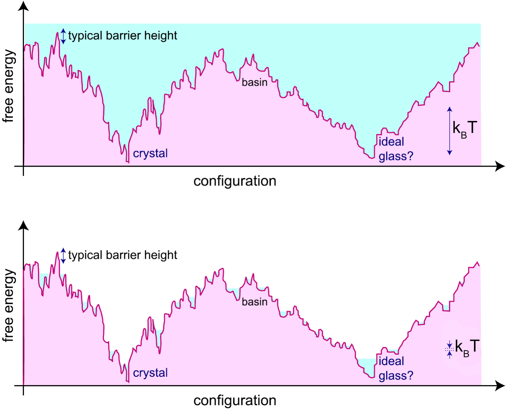
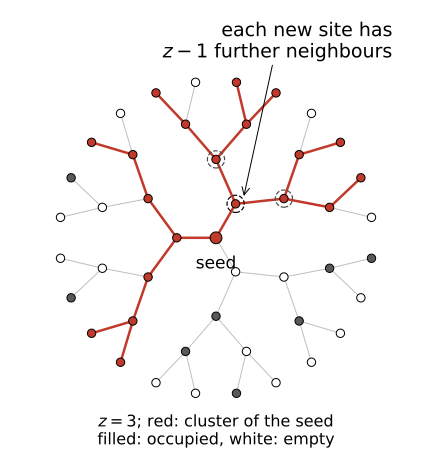

::: {.callout-tip appearance="simple"}
## Learning outcomes

1.  Distinguish equilibrium from arrested states using energy landscapes, ergodicity and configurational entropy.
2.  Describe the phenomenology of the glass transition (two-step relaxation, strong and fragile glassformers, protocol-dependent $T_g$) and compare thermodynamic (Adam-Gibbs) and dynamical (facilitation) explanations.
3.  Explain how physical gels form via percolation and arrested spinodal decomposition, and characterise their structure with $g(r)$ and $S(q)$.
:::

In these chapters we have been considering systems implicitly (or explicitly) in thermal equilibrium with a surrounding environment. This is typically some kind of dispersion medium (a solvent). But we have also been more demanding: we have required that the dispersed phase (the colloids, the polymers the anisotropic particles of liquid crystals) have explored exhaustively their free energy options and that they are truly in some macrostate corresponding to a global, stable thermal equilibrium state.

Equilibrium signifies time reversibility.

::: {.column-margin} 
At equilibrium the **entropy production** is **zero**: any transformation between two times $t_1, t_2$ is **reversible**.
:::


Many fluids, whether simple liquids like argon or complex liquids such as colloids and polymers, can be **rapidly cooled** (quenched) to temperatures well below their equilibrium freezing point without crystallization occurring on experimental timescales. In thermodynamic terms this is interpreted as a failure of the system to reach its true equilibrium (minimum free energy) state, namely the ordered crystalline phase. At these low temperatures, the dynamics slows down and the large scale structures remain disordered as the parent fluids. This slow dynamics is however characterised by a continuous drift *towards* equilibrium, with all of the characteristics of the systems (slowly) evolving during time as the system **ages**. 

These **relaxation dynamics** are examples of **nonequilibrium processes**: the system spontaneously relaxes under the competing constraints of its kinetic rules (typically, diffusion mechanisms) and from the shape of its free energy profile. 

In this chapter we are going to consider two paradigmatic cases of such nonequilibrium dynamics

- **glasses**, where the system falls out of equilibrium due to a dramatic slowing down of dynamics as temperature decreases or density increases, leading to a rigid but disordered structure.
- **physical gels**, where the system forms a disordered, arrested state due to the formation of a percolating network of reversible bonds (e.g., hydrogen bonds or van der Waals interactions) between particles.

What is distinctive of both gels and glasses is that they are both examples of amorphous materials that behave like solids: they lack long-range atomic order yet resist deformation like crystalline solids. Indeed one can calculate properties that are distinctive of solids for both gels and glasses, including:

- **Elastic moduli** (such as the shear modulus $G$ and bulk modulus $K$): Both gels and glasses exhibit a finite shear modulus, meaning they can sustain a static shear stress without flowing, unlike liquids.
- **Yield stress**: They can support a certain amount of stress before yielding or flowing, a property absent in equilibrium fluids.
- **Vibrational density of states**: Amorphous solids display a characteristic "boson peak" in their vibrational spectrum, distinct from the phonon modes of crystals.

These features highlight that rigidity and solidity do not require crystalline order; amorphous materials like gels and glasses can be mechanically solid while remaining structurally disordered. Indeed, the border between solidity and fluidity has been questioned in recent research work, emphasizing how this depends on observational timescales and the notion of metastability, see @sausset2010solids.


## Energy landscapes {#sec-energy-landscapes}

The **free energy landscape** is a conceptual framework used to describe the multitude of possible configurations (microstates) of a system and their associated free energies. Each point in this high-dimensional landscape corresponds to a (coarse-grained) state of the system, i.e. a set of similar particle arrangements, and the height at that point represents the free energy of that state, $F=-k_BT\ln P$ where $P$ is the probability of finding the system in that state. In particular, the landscapes is characterised by the presence of free energy **minima** (valleys) which correspond to stable or metastable states—configurations where the system tends to reside and local maxima (barrier) between the valleys, representing the so-called **transition states**.

Various minima can be clustered together when their energies are relatively close, i.e. when the barriers that separate them are of the order of the energy from thermal fluctuations $k_B T$. These clusters of minima are known as **(meta)-basins** and are very important for amorphous systems: the same system at the same temperature can display similar macroscopic characteristic not because these reflect the properties of one particular minimum, but because they are the result of local averaging within a given metabasin.

In the context of supercooled liquids and glasses, the landscape is rugged, with many local minima separated by high barriers. At high temperatures, the system can easily hop between minima (exploring many configurations), but as the temperature decreases, it becomes trapped in deeper minima, leading to slow dynamics and eventual dynamical arrest (glass formation).

Similarly, in the case of gels, the free energy landscape is also rugged, but the system becomes arrested due to the formation of a percolating network of reversible bonds. Instead of being trapped in deep minima solely by energetic barriers (as in glasses), the system's dynamics are constrained by the connectivity of the network. The system can only relax if enough bonds break and reform to allow large-scale rearrangements, which becomes increasingly unlikely as the network spans the system. Thus, the arrested state in gels is associated with the system being confined within a region of the landscape corresponding to networked, mechanically stable configurations, separated from other regions by high barriers related to breaking the network connectivity.

{ width=80%}

The free energy landscape is helpful as it suggests ways to enumerate distinct conformations of a disordered system: the various metabasins can be in principle enumerated. Their number $N_{\rm minima}$ allows us to define a **configurational entropy**:

$$
S_{\rm conf} = k_B \ln N_{\rm minima}
$$

How is this different from the total entropy? In principle, the total entropy $S$ can be obtained from thermodynamic relations, for example as an integral over the pressure:

$$
S(V) = S(V_0) + \int_{V_0}^{V} \left( \frac{\partial P}{\partial T} \right)_{V'} dV' \quad (\text{at fixed } T)
$$

or, more commonly for liquids and glasses at constant volume,

$$
S(T) = S(T_0) + \int_{T_0}^{T} \frac{C_V(T')}{T'} dT'
$$

where $C_V$ is the heat capacity at constant volume and $T_0$ is a reference temperature. For a fluid like a gas, only the total entropy is well defined. Even for a liquid at high temperature this is the case, because there are no meaningful metabasins in the free energy profile.

It is only as we decrease the temperature further that the metabasins can be defined (via [*coarse-graining*](soft-matter_intro.qmd#coarse-graining)). These reference conformations can be used to split the total entropy into two contributions

$$S = S_{\rm conf}+S_{\rm vib}$$

where $S_{\rm vib}$ is the vibrational entropy around the reference conformations (the same kind of entropy that makes [hard spheres crystallise](soft-matter_colloids.qmd#dense-packing-metastability-and-crystalisation): in the crystal each sphere gains free volume to vibrate), and is mainly due to thermal fluctuations. In this sense, we are describing the thermodynamics of a disordered system in a way closer to what we would do for a crystal, where the reference conformations are provided by the crystalline packings (e.g. FCC, HCP, BCC etc.).


## Glasses

### Glass formation

There exist numerous types of glassformers: these include atomic glasses (such as silicate glasses and metallic glasses), molecular glasses (organic molecules, sugar glasses), polymer glasses ([amorphous polymers](soft-matter_polymers.qmd#bulk-polymers)), colloidal glasses ([dense suspensions of colloidal particles](soft-matter_colloids.qmd#dense-packing-metastability-and-crystalisation)). Each type is characterized by the nature and scale of its constituents, the interactions that frustrate crystallization, and its physical properties. The table below summarizes some representative examples:

| Glassformer         | Scale of Constituents      | Properties                                      |
|---------------------|---------------------------|-------------------------------------------------|
| Silicate glass      | Atomic (Si, O atoms)      | Hard, transparent, high melting point           |
| Metallic glass      | Atomic (metal atoms)      | High strength, elastic, corrosion resistant     |
| Polymer glass       | Macromolecular (polymers) | Flexible, low density, tunable glass transition |
| Colloidal glass     | Mesoscopic (colloids, ~nm–μm) | Opaque, tunable rheology, soft solid-like   |
| Molecular glass     | Molecular (organic molecules) | Low melting point, fragile, optical uses   |
| Sugar glass         | Molecular (sucrose, glucose)  | Brittle, water soluble, low thermal stability   |
| Chalcogenide glass  | Atomic (S, Se, Te atoms)  | Infrared transparency, phase-change memory      |

All of them are **amorphous**, in the sense that they are disordered and do not possess long range positional or orientational order. All of them are different, but they are often formed following a similar protocol.

How are glasses formed? The figure below illustrates the standard route. First of all, one selects systems for which crystal formation (via [nucleation and growth](../phase-transitions/nucleation-and-growth.qmd)) is **hindered** (or in other words, **frustrated**): this can be because of  the overall composition (silicate glasses, i.e. window glasses, have many components) or because of competing interactions (binary mixtures may have interactions between the A and B components that favour mixing without crystallisation).


Then, for a chosen composition, one cools down the liquid across the temperature where in principle (if given enough time) the system would crystallise (dubbed $T_m$). The liquid becomes a so-called **supercooled liquid** which is a state of local equilibrium that has access to many disordered basins, but not the crystalline one (see energy landscape picture above).


![Standard picture of glass formation: a (local) equilibrium state (the supercooled liquid) is cooled at a certain cooling rate $R$. The cooling rate is fast enough to avoid crystallization (freezing) at $T_m$. At the glass transition temperature $T_g$ the structural relaxation time of the system exceeds the observation timescale and the system falls off equilibrium. The experimental glass transition temperature is not unique and depends on the protocol: fast cooling rate lead to higher glass transition temperatures.](./figs/glass.svg){width=80%}


As we keep on cooling the supercooled liquid to lower and lower temperature, the molecules or constituents move more and more slowly, so that the diffusivity is progressively reduced. This slowing down is typically characterized in terms of autocorrelation functions of the density.

A common way to quantify this is through the (self-part) **intermediate scattering function** $F_s(q, t)$, which measures how density fluctuations at a given wavevector $q$ decay over time:

::: column-margin
The full intermediate scattering function $F(q, t)$ contains two contributions:

- **Self part** $F_s^{\text{self}}(q, t)$: Measures the correlation of each particle with its own initial position. It captures single-particle dynamics (how far a particle moves from where it started).
- **Collective part**: Measures correlations between different particles, reflecting how density fluctuations evolve collectively. The full (collective) function is given by
    $$
    F(q, t) = \frac{1}{N} \left\langle \sum_{j,k=1}^N e^{i \mathbf{q} \cdot [\mathbf{r}_j(t) - \mathbf{r}_k(0)]} \right\rangle
    $$
In glassy systems, the self part is sensitive to particle mobility (e.g., caging and hopping), while the collective part describes how groups of particles rearrange together. Both are important for understanding relaxation and dynamical arrest.
:::


<div style="border: 2px solid red; padding: 1em; border-radius: 8px; background-color: transparent;">
$$
F_s^{\text{self}}(q, t) = \left\langle \frac{1}{N} \sum_{j=1}^N e^{i \mathbf{q} \cdot [\mathbf{r}_j(t) - \mathbf{r}_j(0)]} \right\rangle
$$
</div>


At high temperatures, $F_s(q, t)$ decays rapidly, indicating fast relaxation. As temperature decreases, the decay becomes much slower, often exhibiting a two-step relaxation: a rapid initial drop (the "$\beta$-relaxation") followed by a long plateau and then a slow final decay (the "$\alpha$-relaxation"). The time at which $F_s(q, t)$ decays to a certain fraction (e.g., $1/e$) defines the **structural relaxation time** $\tau_\alpha$, which represents the typical time for a particle to move over a lengthscale $\sim 2\pi/q$. 

{width=80%}

As the supercooled liquid gets colder and colder, the relaxation time increases rapidly, eventually of many orders of magnitude. At some *experimentally determined* temperature the relaxation time is larger than the observation time, i.e.

$$\tau_{\alpha}>t_{\rm obs}$$

A system is **ergodic** if the time average of an observable over the observation time equals its ensemble average,
$$\overline{A}=\frac{1}{t_{\rm obs}}\int_0^{t_{\rm obs}}A(t)\,dt=\langle A\rangle,$$
which requires the system to explore its representative configurations within $t_{\rm obs}$, i.e. $t_{\rm obs}\gg\tau_\alpha$.

This means that it is impossible to take time averages to estimate thermodynamic properties of the system, because the system does not satisfy any longer the minimal requirement of the ergodic hypothesis. This **failure of ergodicity** means that the system effectively falls **out of equilibrium**, because it does not explore all relevant microstates within the available time. The system has become a **glass**. The temperature at which this clearly non-ordinary (and non-thermodynamic!) transition occurs is called the **experimental glass transition temperature** $T_g$.

A key feature of the glass transition is that there is no unique glass transition temperature $T_g$: the transition temperature itself depends on how fast we are cooling the liquid down. It is a **protocol dependent** property. We can understand this by referring back to the energy landscape: at high temperatures, the system has enough thermal energy to explore many minima in the landscape, hopping over barriers with ease. As the temperature decreases, the barriers become increasingly difficult to cross within the available observation time. If the cooling is slow, the system can equilibrate and find deeper minima, resulting in a lower $T_g$. If the cooling is fast, the system becomes trapped in higher-energy, shallower minima, and $T_g$ is higher. Therefore, the glass transition is not a sharp thermodynamic phase transition, but a kinetic phenomenon determined by the interplay between the system's relaxation time and the timescale of the experimental protocol.

### Viscosity and relaxation times

The structural relaxation time extracted from correlation functions such as the intermediate scattering function is proportional to a macroscopic property, the **viscosity**

$$\tau_\alpha \propto \eta$$

and hence the viscosity at the glass transition increases rapidly (diverges) like $\tau_\alpha$. 

::: {.callout-note collapse="true"}

#### Relationship between viscosity and structural relaxation time

The proportionality between viscosity $\eta$ and the structural relaxation time $\tau_\alpha$ can be understood using linear response theory and the Green-Kubo relations.

The viscosity is given by the Green-Kubo formula as an integral of the stress autocorrelation function:
$$
\eta = \frac{V}{k_B T} \int_0^\infty \langle \sigma_{xy}(0) \sigma_{xy}(t) \rangle dt
$$
where $\sigma_{xy}$ is the off-diagonal component of the stress tensor.

In supercooled liquids and glasses, the decay of the stress autocorrelation function is governed by the same slow structural relaxation processes that control $\tau_\alpha$. Thus, the integral is dominated by timescales of order $\tau_\alpha$, leading to:
$$
\eta \sim G_\infty \tau_\alpha
$$
where $G_\infty$ is the instantaneous (high-frequency) shear modulus.

This proportionality holds in the regime where the relaxation is dominated by structural rearrangements (i.e., near the glass transition), and is supported by both experiments and simulations. Therefore, the dramatic increase in viscosity as the glass transition is approached directly reflects the growth of the structural relaxation time.

:::


{ width=60% }

This dramatic increase in relaxation time is a hallmark of glassy dynamics and underlies the kinetic arrest observed in glasses.

Presently, we do not have a single unified theory of the glass transition: there is no universal law capable to predict the viscosity (or the relaxation times) of glassy systems from specific microscopic parameters. To date, the origin of the glass transition remains one of the [major unsolved problems condensed matter physics](https://en.wikipedia.org/wiki/List_of_unsolved_problems_in_physics#Condensed_matter_physics).

First steps are typically phenomenological: glasses are classified as **strong** or **fragile** based on how their viscosity (or relaxation time) increases as temperature decreases toward the glass transition temperature $T_g$. We have seen earlier in @sec-cnt that activated process are often governed by what are called Arrhenius laws, with a rate $R\propto \exp\left[-\Delta E/k_B T\right]$ where $\Delta E$ is an energy barrier. Viscosity curves can be fitted by empirical models inspired by the activated picture:


- **Strong glasses** (e.g., silica, SiO$_2$) follow an Arrhenius law :
    $$
    \eta(T) = \eta_0 \exp\left(\frac{E_A}{k_B T}\right)
    $$
    where $E_A$ is an activation energy. The plot of $\log \eta$ vs $1/T$ is a straight line.

- **Fragile glasses** (e.g., o-terphenyl, many polymers) show super-Arrhenius behavior, often described by the Vogel-Fulcher-Tammann (VFT) equation:
    $$
    \eta(T) = \eta_0 \exp\left(\frac{B}{T - T_0}\right)
    $$
    where $B$ and $T_0$ are empirical parameters. The plot of $\log \eta$ vs $1/T$ is highly curved.

The distinction is visualized in the so-called **Angell plot**, where strong glasses show nearly linear behavior, while fragile glasses show a dramatic upturn as $T \to T_g$.

These models are suggestive of a **thermodynamic** origin of the glass transition. Indeed, it is possible to think of the emerging barrier $E_A$ and $B$ as the result of some free energy expression from the sampling of the energy landscapes in various basins. 


#### Cages and cooperativity

Before discussing theories, it helps to give a microscopic picture of the two-step decay of $F_s(q,t)$. At low temperatures each particle is trapped in a **cage** formed by its neighbours. It rattles inside the cage, which gives the fast $\beta$-relaxation on picosecond timescales, almost independent of temperature, and only rarely escapes from it, which gives the slow $\alpha$-relaxation. The time $\tau_\alpha$ grows by many orders of magnitude on cooling while $\tau_\beta$ barely changes. Because of this **separation of timescales**, at any instant almost all particles are caged and only a few are moving.

To escape, a particle needs its neighbours to make room, but the neighbours are caged too. Relaxation must therefore be **cooperative**. Any theory of the glass transition has to explain how large the cooperatively moving regions are, and what sets the time needed to rearrange them. Thermodynamic theories answer in terms of the number of available configurations; dynamical theories in terms of how mobility spreads through the system.

#### Connection between VFT and configurational entropy: the Adam-Gibbs model

A key theoretical link between the dramatic slowdown of dynamics (as described by the VFT law) and the underlying thermodynamics is provided by the **Adam-Gibbs model**, details in @bouchaud2004adam. 

This model proposes that the structural relaxation time $\tau_\alpha$ is controlled by the **configurational entropy** $S_{\rm conf}$, which counts the number of distinct amorphous basins available to the system.

The key idea is the existence of **cooperatively rearranging regions** (CRRs): to relax, particles need to move together to explore a new metabasin in the energy landscape.

The sketch of the theory is the following. At low temperatures a particle cannot move alone: its neighbours have to move too. A CRR is then the **smallest** region that can rearrange into a new configuration without requiring changes outside its boundary. Why the smallest? The barrier for a cooperative rearrangement grows with the number of particles that move together, so relaxation is dominated by the smallest regions that can rearrange at all.

To rearrange, a region must have at least two distinct configurations available, $W^*=2$. We **assume** that each CRR has just this bare minimum, so that it carries the configurational entropy $s^*=k_B\ln 2$, the same at every temperature. This is a postulate of Adam and Gibbs: one could imagine that at low temperatures a region needs more alternatives than the minimum to actually relax.

The size of the CRRs then follows from counting. The system is a mosaic of $M_{CRR}$ CRRs of $n_{CRR}$ particles each, so trivially

$$N=M_{CRR}\,n_{CRR}.$$

The CRRs rearrange independently of each other, so their configurational entropies add, each contributing $s^*$:

$$S_{\rm conf}=M_{CRR}\,s^*.$$

Dividing the two, with $s_{\rm conf}=S_{\rm conf}/N$ the configurational entropy per particle,

$$n_{CRR}(T)=\frac{s^*}{s_{\rm conf}(T)}.$$

The configurational entropy decreases on cooling (as Kauzmann's data show, and as required by a positive configurational heat capacity, $ds_{\rm conf}/dT=c_{\rm conf}/T\geq0$), while $s^*$ is fixed. Therefore the CRRs grow as the temperature is lowered.

A metabasin of the whole system corresponds to one choice of configuration for every CRR: a rearrangement of a single CRR moves the system to a neighbouring metabasin.

We then assume **activated dynamics**: rearranging costs a barrier $\Delta\mu$ per particle, so a CRR must cross a barrier proportional to its size,

$$\Delta E(T) = n_{CRR}(T)\,\Delta\mu = \frac{s^*\Delta\mu}{s_{\rm conf}(T)}.$$

The Arrhenius law $\tau_\alpha=\tau_0 e^{\Delta E/k_BT}$ then gives the Adam-Gibbs relation [@adam1965temperature]:
$$
\tau_\alpha(T) = \tau_0 \exp\left(\frac{A}{T s_{\rm conf}(T)}\right),\qquad A=\frac{s^*\Delta\mu}{k_B}.
$$
As temperature decreases, $s_{\rm conf}$ drops, leading to a rapid increase in $\tau_\alpha$.

To obtain the VFT law we need to know *how* $s_{\rm conf}$ decreases. Following Kauzmann's extrapolation (see below), we assume that it decreases **smoothly** on cooling and vanishes at a finite temperature $T_K$, the Kauzmann temperature. Close to its zero, a smooth function is **linear**:

$$
s_{\rm conf}(T)\simeq K\,\frac{T-T_K}{T_K},\qquad K>0.
$$

Then $T s_{\rm conf}=K\,\frac{T}{T_K}(T-T_K)$, and the exponent of the Adam-Gibbs relation splits exactly into two terms (partial fractions):
$$
\frac{A}{T s_{\rm conf}}=\frac{B\,T_K}{T\,(T-T_K)}=\frac{B}{T-T_K}-\frac{B}{T},\qquad B=\frac{A}{K}.
$$
The first term diverges at $T_K$; the second stays finite there and changes much more slowly. The result is therefore not exactly VFT, but VFT multiplied by a smooth factor $e^{-B/T}$, which close to $T_K$ we can treat as a constant and absorb into the prefactor:
$$
\tau_\alpha(T) \simeq \tau_0'\exp\left(\frac{B}{T - T_0}\right),\qquad T_0=T_K.
$$

Corrections to the linear behaviour of $s_{\rm conf}$ act in the same way: they add terms to the exponent that stay finite at $T_K$. The divergence is controlled by the linear zero alone. Adam and Gibbs themselves arrived, near the temperature where $s_{\rm conf}$ vanishes, at a relation practically coinciding with the empirical Williams-Landel-Ferry (WLF) equation used for polymers, which is mathematically equivalent to VFT [@adam1965temperature]. In the problem class we see how calorimetry gives a specific form of $s_{\rm conf}(T)$ for which the VFT law is exact.

Thus, the Adam-Gibbs model provides a thermodynamic interpretation of the VFT law, connecting the kinetic slowdown to the loss of configurational entropy as the glass transition is approached. It also makes a testable prediction: the temperature $T_0$ obtained by fitting relaxation times should coincide with the temperature $T_K$ obtained from calorimetry, where $s_{\rm conf}$ is estimated as the excess entropy of the liquid over the crystal (an approximation, since the excess also contains a vibrational part). For many fragile liquids the two agree closely [@richert1998dynamics].

The temperature $T_K$ is named after Kauzmann, who noticed that if the entropy difference between the supercooled liquid and the crystal is extrapolated below $T_g$, it vanishes at a finite temperature $T_K>0$, and would even become negative below it [@kauzmann1948nature]. This **Kauzmann paradox** is avoided in practice because the liquid falls out of equilibrium at $T_g$ before reaching $T_K$.

{width=60%}

#### Alternative perspective: Dynamical facilitation and the parabolic law

While thermodynamic models like Adam-Gibbs relate the glass transition to configurational entropy, a radical alternative approach is the **dynamical facilitation theory**, see @chandler2010dynamics for more details. This framework emphasizes that glassy slowdown arises from the dynamics themselves, rather than underlying thermodynamic changes.

Here the central observation is that the dynamics of all glassy systems is highly heterogeneous in space and time: some regions are very mobile, while others are essentially frozen. This **dynamic heterogeneity** is a hallmark of glassy dynamics. It corresponds to a **dynamical coexistence** between fast-relaxing and slow relaxing region that can be formalised as a **dynamical phase transition**.


The starting point is again the cage picture. Thanks to the separation of timescales between rattling and escaping, we can coarse-grain space and time into regions that are either **mobile** (a cage has just broken) or **immobile** (still caged). At low temperatures mobile regions are rare, localised **excitations**. Creating one costs an energy $J$, so their concentration is $c\simeq e^{-J/k_BT}$. As a collection of independent excitations, their thermodynamics is trivial: there is no thermodynamic transition.

The theory rests on one **postulate**, the *kinetic constraint*: an immobile region can relax only if a neighbouring region is mobile. Mobility *facilitates* further mobility [@garrahan2003coarse]. This is the counterpart of the postulate on $s^*$ in the Adam-Gibbs model.

The slowdown then comes from the way relaxation propagates. Excitations are typically a distance $\ell\sim c^{-1/d_f}=e^{J/(d_f k_BT)}$ apart, where $d_f$ is a fractal dimension. To relax a region, mobility has to be brought there over a distance $\ell$ through a chain of facilitated moves. Because of the constraint this chain is **hierarchical**: to move further, the system must first create intermediate excitations, then remove them. For the simplest constrained models (such as the East model) the resulting energy barrier grows only logarithmically with distance [@sollich1999glassy],

$$
\Delta E(\ell)\simeq\gamma\,J\ln\ell ,
$$

with $\gamma$ a constant. Using the Arrhenius law,

$$
\ln\tau_\alpha\simeq\frac{\Delta E(\ell)}{k_BT}\simeq\frac{\gamma}{d_f}\left(\frac{J}{k_BT}\right)^2 .
$$

The barrier grows on cooling because excitations become sparser, so the dynamics is super-Arrhenius. Facilitated dynamics only sets in below an onset temperature $T_o$ (above $T_g$; not to be confused with the VFT $T_0$). Measuring from there gives the **parabolic law**

$$
\ln\frac{\tau_\alpha}{\tau_o}\simeq\frac{\gamma}{d_f}\,\frac{J^2}{k_B^2}\left(\frac{1}{T}-\frac{1}{T_o}\right)^2 .
$$

Unlike the VFT law, the parabolic law does not diverge at finite $T$ but still captures the super-Arrhenius growth of relaxation times. 

Interestingly, both perspectives fit the experimental data well. The figure below shows the $\alpha$-relaxation times of glycerol, obtained from the peak frequency $f_{\max}$ of the dielectric loss as $\tau_\alpha=1/(2\pi f_{\max})$ [@nielsen2009prevalence], fitted with the VFT law and with the parabolic law. Over the measured range both fits deviate from the data by less than $0.02$ decades, yet they describe very different physics: the VFT fit diverges at $T_0\approx128$ K, while the parabolic fit has an onset at $T_o\approx313$ K and never diverges. The two only part ways below $T_g$, where the liquid cannot be equilibrated.

{width=70%}

Relaxation times alone therefore cannot decide between the two scenarios [@hecksher2008little]. Tests must come from other predictions (whether $T_0$ coincides with $T_K$, whether static lengthscales grow, how excitations and dynamical heterogeneity behave), or from reaching lower temperatures, for example with ultrastable glasses prepared by vapour deposition or with swap Monte Carlo simulations. Recent research suggests that close to the glass transition temperature the microscopic mechanisms resemble dynamical facilitation.

::: {.callout-note collapse="true"}
## Code for this figure

```python
import numpy as np
import matplotlib
import matplotlib.pyplot as plt
from scipy.optimize import curve_fit

# Glycerol dielectric loss-peak frequencies, Nielsen et al. J. Chem. Phys. 130, 154508 (2009),
# Glass and Time data repository; tau_alpha = 1/(2 pi f_max).
T = np.array([235.971, 231.984, 227.969, 223.967, 219.977, 215.979,
              211.948, 207.949, 203.958, 199.954, 195.933, 191.963])
log10_fmax = np.array([4.6155, 4.2429, 3.8446, 3.4324, 2.9656, 2.4563,
                       1.9076, 1.2992, 0.6348, -0.1085, -0.9567, -1.8954])
log10_tau = -(log10_fmax + np.log10(2 * np.pi))

def vft(T, log10_tau0, B, T0):
    return log10_tau0 + B / (T - T0) / np.log(10)

def parabola(T, log10_tau_o, J2, T_o):
    return log10_tau_o + J2 * (1 / T - 1 / T_o) ** 2 / np.log(10)

p_vft, _ = curve_fit(vft, T, log10_tau, p0=[-14, 2000, 120])
p_par, _ = curve_fit(parabola, T, log10_tau, p0=[-10, 5e5, 300])
rms = lambda f, p: np.sqrt(np.mean((log10_tau - f(T, *p)) ** 2))
print(f"VFT: B = {p_vft[1]:.0f} K, T0 = {p_vft[2]:.1f} K, rms = {rms(vft, p_vft):.3f} decades")
print(f"parabola: J/k_B = {np.sqrt(p_par[1]):.0f} K, T_o = {p_par[2]:.1f} K, rms = {rms(parabola, p_par):.3f} decades")

T_line = np.linspace(150, 330, 400)
fig, ax = plt.subplots(figsize=(7, 5))
ax.axvspan(1000 / T.max(), 1000 / T.min(), color="0.92", label="measured range")
ax.plot(1000 / T_line, vft(T_line, *p_vft), color="crimson", lw=2,
        label=f"VFT, divergence at $T_0={p_vft[2]:.0f}$ K")
T_below_onset = T_line[T_line < p_par[2]]  # the parabolic law applies only below the onset
ax.plot(1000 / T_below_onset, parabola(T_below_onset, *p_par), color="royalblue", lw=2, ls="--",
        label=f"parabolic law, onset $T_o={p_par[2]:.0f}$ K")
ax.plot(1000 / T, log10_tau, "ko", ms=7, label="glycerol (dielectric)")
ax.axhline(2, color="0.4", lw=1, ls=":")
ax.text(3.08, 2.25, r"$\tau_\alpha=100$ s ($T_g$)", color="0.3", fontsize=13)
ax.set_xlim(3.0, 6.7)
ax.set_ylim(-9, 12)
ax.set_xlabel(r"$1000/T$  [K$^{-1}$]", fontsize=16)
ax.set_ylabel(r"$\log_{10}\,\tau_\alpha$  [s]", fontsize=16)
ax.legend(loc="upper left", fontsize=13, frameon=False)
ax.tick_params(labelsize=13)
fig.tight_layout()
plt.show()
```
:::


Here below is a the visual representation of the time evolution of the magnitude of the displacement field in a model of glass governed by dynamical facilitation, see @hasyim2024emergent for more details.




## Physical gels

The word *gel* signifies many different things to different scientific communities. In the context of soft matter physics, a physical gel is typically understood as a system in which the constituent particles or polymers are connected via reversible, non-covalent bonds to form a percolating network that spans the entire sample. This network imparts solid-like mechanical properties to the material, even though the underlying structure remains disordered and fluid-like on a microscopic scale. 

Physical gels differ from chemical gels, where the network is formed by *irreversible* covalent bonds. In physical gels, the bonds can break and reform dynamically,  have an energy of order a few to tens of $k_BT$ (strong enough to persist, weak enough to break and reform), allowing the system to respond to external stresses and sometimes to self-heal. In this sense they are **reversible** systems and often are known as thermoreversible gels. Reversible linking is typically achieved by the formation of dense local regions (e.g. microcrystalline or glassy) or specific junctions (e.g. triple helices in gelatin) that act as *cross-links* to form a spanning network. 

Examples include gelatin desserts, agarose gels, and  colloidal suspensions such as yoghurt, paint, inks where attractive interactions lead to network formation, see @Zaccarelli2007 for a comprehensive review.


The transition from a fluid to a gel state is often associated with the appearance of a system-spanning cluster, which can be described using concepts from **percolation theory**. The mechanical rigidity of the gel arises when this cluster forms and its bonds live long enough to make it effectively **permanent** on the observation time, leading to a dramatic increase in viscosity and the emergence of an elastic response.

[]{#percolation}

::: {.callout-note collapse="true"}
## Percolation

Percolation is the study of an apparently innocent mathematical problem: take a square grid of $L\times L$ sites and randomly label $N$ of them; how does the likelihood of forming a cluster that spans across the grid (i.e. *percolates*) depend on the probability $p=N/L^2$ of having a labelled square?

The problem is interesting for its various applications across domains of science as diverse as networks formation, transport, material science, epidemiology and ecology. It can be solved exactly only in special cases (on trees, and in 2D), but it is very easy to simulate. Percolation is a classic example of a phase transition and critical phenomena. The probability $p_c$ at which a spanning cluster first appears is called the **percolation threshold**. For a large 2D square lattice, $p_c \approx 0.5927$. Below $p_c$, only small, disconnected clusters exist; above $p_c$, a giant connected component spans the system. The transition is **continuous**, i.e. second order.

Percolation exhibits [universal critical exponents](../phase-transitions/scaling.qmd) near $p_c$, making it a cornerstone of statistical physics and network theory.

You can play with percolation on a squared lattice with the code below.

```{pyodide}
#| autorun: true
import numpy as np
import matplotlib.pyplot as plt
from scipy.ndimage import label

def sample_percolation(
    L = 50,  # grid size
    p = 0.2  # occupation probability
):
    # Generate random grid
    grid = np.random.rand(L, L) < p

    # Label clusters
    structure = np.array([[0,1,0],[1,1,1],[0,1,0]], dtype=int) 
    labeled, num_features = label(grid, structure=structure)

    # Find largest cluster
    sizes = np.bincount(labeled.ravel())
    sizes[0] = 0  # background is label 0
    largest_label = sizes.argmax()
    
    # Mask for largest cluster
    mask = labeled == largest_label

    return grid, mask

# sample
p = 0.2
L = 120
grid, mask = sample_percolation(L,p)
# Plot
plt.figure(figsize=(6, 6))
# Show all clusters in gray
plt.imshow(grid, cmap='gray', interpolation='none')

plt.imshow(np.ma.masked_where(~mask, mask), cmap='autumn', alpha=0.8, interpolation='none')
plt.axis('off')
plt.title(f'Percolation in 2D (p={p})\nLargest cluster highlighted in red')
plt.show()
```


```{pyodide}
#| autorun: true 

ps = np.linspace(0.1, 1.0, 50)
L = 500
largest_sizes = []
repeats = 3
for p in ps:
    sizes = []
    for r in range(repeats):
        grid, mask = sample_percolation(L, p)
        sizes.append(mask.sum() / (L * L))  # Fraction of sites in largest cluster
    largest_sizes.append(np.mean(sizes))

plt.figure(figsize=(7, 4))
plt.plot(ps, largest_sizes, marker='o')
plt.xlabel('Occupation probability $p$')
plt.ylabel('Fraction in largest cluster')
plt.title('Percolation transition in 2D')
plt.show()
```

Try fitting $(p-p_c)^\beta$ to the curve just above $p_c$. On a finite lattice the transition is rounded over a window $|p-p_c|\sim L^{-1/\nu}$ (where the clusters become as large as the box), so the fitted exponent is far from the exact value $\beta=5/36$ given below.

#### Why is the percolation transition critical? {.unnumbered}

A quick argument comes from percolation on a tree (the Bethe lattice), where every site has $z$ neighbours and there are no loops.

{width=50%}

 Grow a cluster from an occupied site: every new site has $z-1$ further neighbours, each occupied with probability $p$, so on average it generates $p(z-1)$ new sites. If $p(z-1)<1$ the branches die out and all clusters are finite; if $p(z-1)>1$ they can grow forever. Hence

$$p_c=\frac{1}{z-1}.$$

Call $T$ the mean number of occupied sites in a branch, i.e. reached through one bond pointing away from the seed. The first site of the branch is occupied with probability $p$; if it is, it contributes itself plus $z-1$ sub-branches, which (since the tree has no loops) are copies of the original branch, each with mean $T$. Hence $T=p\,[1+(z-1)T]$, and the mean size of the cluster of the seed, which has $z$ branches, is

$$S=1+zT=1+\frac{zp}{1-p/p_c}\sim(p_c-p)^{-1}$$

diverges at $p_c$, like the susceptibility of the Ising model at $T_c$.

Above $p_c$, take $z=3$ and call $Q$ the probability that a branch is finite: either its first site is empty, or it is occupied and both its sub-branches are finite, $Q=1-p+pQ^2$, so that $Q=(1-p)/p$. A site belongs to the infinite cluster if it is occupied and not all of its three branches are finite:

$$P_\infty=p\,(1-Q^3)\simeq6\,(p-p_c).$$

The order parameter grows continuously from zero, with no jump and no coexistence: the transition is second order, with the mean-field exponents $\beta=1$ and $\gamma=1$ (exact for $d\geq6$). The size $\xi$ of the typical finite clusters plays the role of the correlation length and diverges as $\xi\sim|p-p_c|^{-\nu}$. This tree calculation is in fact the classic Flory-Stockmayer theory of gelation [@stauffer1994introduction].

The following table illustrates that various values of the critical percolation probability are known for various lattices, either exactly or via simulation. Notice that this non-universal feature, the critical $p_c$, decreases with increasing dimensionality: at higher dimensions, the connectivity is naturally higher and so a comparatively smaller fraction of the system is required in order to find a percolating path. The Bethe lattice value $1/(z-1)$ becomes a better estimate as the coordination grows.

| Lattice Type    | Dimension | Coordination $z$ | $p_c^{site}$ | $p_c^{bond}$ |
| --------------- | --------- | ---------------- | ------------ | ------------ |
| Square          | 2         | 4                | 0.5927       | **0.5**      |
| Triangular      | 2         | 6                | **0.5**      | 0.3473       |
| Cubic           | 3         | 6                | 0.3116       | 0.2488       |
| FCC             | 3         | 12               | 0.199        | 0.120        |
| Hypercubic (6D) | 6         | 12               | 0.109        | 0.094        |
| Bethe lattice   | $\infty$  | $z$              | $1/(z-1)$    | $1/(z-1)$    |


Instead, other properties of percolation are **universal**: these are the critical exponents of observables on the lattice and do not depend on the lattice details: the probability to find a site in the percolating cluster $P_{\infty}\propto (p-p_c)^{\beta}$, the mean size of the finite clusters $S\propto|p-p_c|^{-\gamma}$ and their typical linear size $\xi\propto|p-p_c|^{-\nu}$.

| Dimension $d$   | $\beta$        | $\gamma$        | $\nu$         |
| --------------- | -------------- | --------------- | ------------- |
| 2               | **5/36**       | **43/18**       | **4/3**       |
| 3               | ≈ 0.41         | ≈ 1.80          | ≈ 0.88        |
| ≥6 (Mean-field) | **1**          | **1**           | **1/2**       |


:::

In the case of physical gels, percolation is a required ingredient for mechanical stability: in the absence of a large spanning percolating network, it is not possible for the gel to sustain external stresses or even self-generated stresses such as its own weight under gravity. Close to the gel point the shear modulus vanishes as a power law, $G\sim(p-p_c)^t$, while on the fluid (sol) side the viscosity diverges as $\eta\sim(p_c-p)^{-s}$. de Gennes noticed that the elasticity of a percolating network is analogous to the conductivity of a random network of resistors, which gives $t\approx2$ in 3D [@degennes1976relation]; experiments on real gels find exponents of this order, with considerable scatter.

::: {.content-visible when-format="live-html"}

:::


### Colloid-polymer mixtures as an example 


When the colloids are significantly larger than the polymers, the resulting depletion interaction is attractive and very short ranged: it is a so-called **sticky** interaction, ideally suited to form robust physical bonds where, the colloids cluster in a nonequilibrium, branched, dense phase.

The resulting phase diagrams differ significantly from the ones of simple liquids (e.g., Lennard-Jones interactions): the liquid-gas coexistence curve (the binodal) becomes metastable.


![Phase diagrams of colloid-polymer mixtures for different values of the size ratio parameter $q=\sigma_{\rm polymer}/\sigma_{\rm colloid}$. Left: very small size ratio make the gas liquid binodal (enclosing the yellow fluid-fluid region) metastable to gas-solid phase separation. Centre: as we increase the size ratio, the liquid pocket at high density starts developing. Right: for almost equal sizes the phase diagram is reminiscent of the one of simple fluids (e.g. Lennard-Jones) after noticing that the polymer reservoir packing fraction plays a role inverse to the temperature. Adapted from @dijkstra1999phase.)](./figs/colloid-polymers.svg)

Given the very short range of the interactions, models of colloid polymer mixtures can approximate the Asakura-Oosawa potential (see @sec-ao-potential) using even simpler pair-wise interactions. For example, for Monte-Carlo simulations and theoretical calculations one often uses the **square-well** model,

The square-well potential $U(r)$ is defined as:

$$
U(r) = 
\begin{cases}
\infty & r < \sigma \\
-\epsilon & \sigma \leq r < \lambda \sigma \\
0 & r \geq \lambda \sigma
\end{cases}
$$

where $\sigma$ is the particle diameter (hard core), $\epsilon$ is the well depth (attractive strength), and $\lambda$ controls the range of the attraction.

```{python}
#| echo: false
import numpy as np
import matplotlib.pyplot as plt

# Parameters
sigma = 1.0         # Hard core diameter
epsilon = 1.0       # Well depth
lambda_ = 1.2       # Range parameter

# r values
r = np.linspace(0.7, 2.0, 500)
U = np.zeros_like(r)

# Square well potential
U[r < sigma] = np.inf
U[(r >= sigma) & (r < lambda_ * sigma)] = -epsilon
U[r >= lambda_ * sigma] = 0

# Plot
plt.figure(figsize=(7,4))
plt.axhline(0, color='k', lw=0.5)
plt.plot(r, U, label='Square-well potential $U(r)$', color='C0')
# Shade area for hard core region
plt.fill_between(r, -1.2*epsilon, 2, where=(r < sigma), color='gray', alpha=0.3, label='Hard core ($r<\sigma$)')
# plt.axvline(sigma, color='k', linestyle='--', label=r'Hard core $r=\sigma$')
plt.axvline(lambda_ * sigma, color='C1', linestyle='--', label=r'Well edge $r=\lambda\sigma$')
plt.axhline(-epsilon, color='C2', linestyle=':', label=r'Well depth $-\epsilon$')

plt.ylim(-1.2*epsilon, 2)
plt.xlim(0.7, 2.0)
plt.xlabel(r'$r$')
plt.ylabel(r'$U(r)$')
plt.title('Square-well potential')
plt.legend(frameon=False)
plt.show()
```

For molecular dynamics one often employs the so-called **Morse potential**, which combines fast exponentially decaying tails and a repulsive core in a simple analytical form 

$$
U_{\mathrm{Morse}}(r) = D \left[ e^{-2\alpha (r - r_0)} - 2 e^{-\alpha (r - r_0)} \right]
$$

where $D$ is the well depth, $\alpha$ controls the range (steepness) of the potential, and $r_0$ is the equilibrium bond distance.

```{python}
#| echo: false
# Morse potential parameters`
D = 1.0        # Depth of the potential well
alpha = 10.0   # Controls the range (steepness)
r0 = 1.0       # Equilibrium bond distance

# r values (reuse from above)
U_morse = D * (np.exp(-2 * alpha * (r - r0)) - 2 * np.exp(-alpha * (r - r0)))

# Plot Morse potential
plt.figure(figsize=(7,4))
plt.axhline(0, color='k', lw=0.5)
plt.plot(r, U_morse, label='Morse potential $U_{\\mathrm{Morse}}(r)$', color='C3')
plt.axvline(r0, color='k', linestyle='--', label=r'Equilibrium $r_0$')
plt.axhline(-D, color='C2', linestyle=':', label=r'Well depth $-D$')
plt.xlabel(r'$r$')
plt.ylabel(r'$U(r)$')
plt.title('Morse potential')
plt.legend(frameon=False)
plt.ylim(-2,5)
plt.show()
```

#### Pair correlations {.unnumbered}

In many situation, pair-wise correlation functions are sufficient to capture gel formation. Both the radial distribution function and the structure factor are able to describe gel formation, but they focus (and are accurate) in different regimes:

The [radial distribution function](soft-matter_colloids.qmd#structural-properties-the-radial-distribution-function) $g(r)$ has best statistics at short distances, capturing the features of the clusters that form the branched network.

{width=60%}


In gels near the percolation threshold, the structure factor $S(q)$ exhibits **scale-free (power-law) behavior** at low $q$:

$$
S(q) \sim q^{-D_f}
$$

where $D_f$ is the **fractal dimension** of the gel network. This power-law regime reflects the absence of a characteristic length scale in the structure—clusters are **self-similar** over a range of sizes.

- For $q$ much smaller than the inverse cluster size, $S(q)$ flattens (finite-size effects).
- For intermediate $q$, $S(q) \sim q^{-D_f}$, indicating fractal geometry.
- For large $q$, $S(q)$ reflects local (non-fractal) structure.

{width=60%}

The exponent $D_f$ is related to the spatial scaling of mass with size in the fractal cluster: $M(R) \sim R^{D_f}$. For percolation, $D_f$ follows from the critical exponents. Up to the scale $\xi$ the spanning cluster is fractal, so in a box of size $\xi$ its density is $M(\xi)/\xi^d\sim\xi^{D_f-d}$. This density is the fraction of sites in the spanning cluster, $P_\infty\sim(p-p_c)^\beta$, and with $\xi\sim(p-p_c)^{-\nu}$ we obtain

$$D_f=d-\frac{\beta}{\nu}.$$

This gives $D_f=91/48\approx1.90$ in 2D and $D_f\approx2.5$ in 3D. Colloidal aggregates are looser, with $D_f\approx1.8$ (diffusion-limited) to $2.1$ (reaction-limited aggregation).

Thus, by analyzing the low-$q$ behavior of $S(q)$, one can extract the fractal dimension and confirm scale-free, self-similar structure in gels.

::: {.callout-note collapse="true"}

# Measuring fractal dimensions: the box-counting algorithm

Fractal dimensions are in practice quite tricky to measure. 
A common method is the **box-counting algorithm**:

1. Overlay a grid of boxes of size $\ell$ over the structure (e.g., a cluster or network).
2. Count the number $N(\ell)$ of boxes that contain any part of the structure.
3. Repeat for different box sizes $\ell$.
4. Plot $\log N(\ell)$ versus $\log(1/\ell)$. For a fractal, this plot is linear over some range, and the slope gives the fractal dimension $D_f$:
$$
N(\ell) \sim \ell^{-D_f}
$$

This method is widely used for experimental images and simulation data to estimate the fractal dimension of clusters, aggregates, or networks.


Below, illustrate this using a known fractal, the [Sierpinski carpet](https://en.wikipedia.org/wiki/Sierpiński_carpet){target="_blank"}, whose fractal dimensions is exactly $D_f = \log{8}/\log{3}\approx 1.8929$

```{python}
# Example: Box-counting fractal dimension for the Sierpinski carpet

import numpy as np
import matplotlib.pyplot as plt

def sierpinski_carpet(n):
    """Generate a Sierpinski carpet of order n as a 2D boolean array."""
    size = 3**n
    carpet = np.ones((size, size), dtype=bool)
    for i in range(n):
        step = 3**i
        for x in range(0, size, 3*step):
            for y in range(0, size, 3*step):
                carpet[x+step:x+2*step, y+step:y+2*step] = False
    return carpet

def box_count(img, box_sizes):
    """Count number of boxes containing any part of the structure for each box size using histogramdd."""
    N = []
    coords = np.argwhere(img)
    for box in box_sizes:
        bins = [img.shape[0] // box, img.shape[1] // box]
        # Assign each coordinate to a box
        hist, _ = np.histogramdd(coords, bins=bins, range=[[0, img.shape[0]], [0, img.shape[1]]])
        N.append(np.count_nonzero(hist))
    return np.array(N)

# Generate Sierpinski carpet
order = 5
carpet = sierpinski_carpet(order)

# Box sizes (powers of 3)
box_sizes = [3**i for i in range(order, 0, -1)]
N_boxes = box_count(carpet, box_sizes)

# Plot Sierpinski carpet
plt.figure(figsize=(4,4))
plt.imshow(carpet, cmap='binary')
plt.title('Sierpinski carpet (order %d)' % order)
plt.axis('off')
plt.show()

# Box-counting plot
plt.figure(figsize=(5,4))
plt.plot(np.log(1/np.array(box_sizes)), np.log(N_boxes), 'o-', label='Box counting')
# Linear fit for slope (fractal dimension)
slope, intercept = np.polyfit(np.log(1/np.array(box_sizes)), np.log(N_boxes), 1)
plt.plot(np.log(1/np.array(box_sizes)), slope*np.log(1/np.array(box_sizes))+intercept, '--', label=f'Fit: $D_f$={slope:.4f}')
plt.xlabel(r'$\log(1/\ell)$')
plt.ylabel(r'$\log N(\ell)$')
plt.title('Box-counting for Sierpinski carpet')
plt.legend(frameon=False)
plt.show()
```

:::


### Arrested spinodal scenario for colloidal gels

But how do colloidal gels come about? A viable scenario is the so-called **arrested spinodal decomposition** scenario. Here, a system is quenched deep into a region of its phase diagram where it would normally phase separate into two distinct phases (e.g., a dense and a dilute phase) via [spinodal decomposition](../phase-transitions/nucleation-and-growth.qmd#spinodal-decomposition). However, before the phase separation can complete, the dynamics of the dense regions slow down dramatically—often due to glassy or jamming behavior—leading to a dynamically arrested, bicontinuous structure.

This process is relevant for colloid-polymer mixtures, protein solutions, and some polymer blends. The resulting gels are characterized by a network-like structure that reflects the early stages of spinodal decomposition, "frozen in" by the arrest of particle motion.

For the arrested spinodal scenario to hold, the system evolves following these steps:

- The system is quenched inside the spinodal region, where spontaneous fluctuations grow.
- Domains of different densities form, but the dense domains become dynamically arrested before macroscopic phase separation completes.
- The final structure is a bicontinuous, percolating network with solid-like mechanical properties. It keeps the characteristic length of the spinodal pattern, visible as a low-$q$ peak in $S(q)$.



Formation of a colloid-polymer gel by arrested spinodal decomposition. Video by Peter Lu, see @lu2008gelation.


![The arrested spinodal scenario mapped on the phase diagram of the dispersed particles (e.g. colloids), adapted from  @Zaccarelli2007. We distinguish various lines: the liquid-gas coexistence (binodal) in red, the spinodal line (inside which the homogeneous fluid is unstable) black dashed, the percolation line (across which a percolating cluster can be detected), the glass transition line (a dynamical line, where the relaxation time of the system exceeds a conventional threshold, e.g. 100 seconds). If a system is quenched from the fluid into the coexistence region, two scenarios are possible: the fluid spontaneously phase separates into two equilibrium phases (liquid and gas, orange horizontal line); or, for a deep enough quench, the dense phase is glassy as it forms, so that proper equilibrium phases cannot be formed and the system separates into a disordered arrested dense phase and a vapor phase (green horizontal line). This second scenario corresponds to physical gel formation via spinodal decomposition.](./figs/arrestedSpinodal.svg){ width=70%}

For more details, see @Zaccarelli2007.


## Summary

The table collects the main results of this chapter. Follow the links to go back to the relevant part.

| Topic | Key result | Remember |
|---|---|---|
| [Energy landscape](#sec-energy-landscapes) | $F=-k_BT\ln P$ of coarse-grained states; minima grouped into metabasins | Glassy landscapes are rugged |
| [Configurational entropy](#sec-energy-landscapes) | $S=S_{\rm conf}+S_{\rm vib}$, $S_{\rm conf}=k_B\ln N_{\rm minima}$ | Counts the distinct basins |
| [Glass formation](#glass-formation) | Cool fast enough to avoid crystallisation; $T_g$ where $\tau_\alpha>t_{\rm obs}$ | Ergodicity is lost; $T_g$ depends on the protocol |
| [Relaxation](#glass-formation) | Two-step $F_s(q,t)$: $\beta$ (cage), $\alpha$ (structural); $\tau_\alpha\propto\eta$ | Dramatic slowing down |
| [Strong vs fragile](#viscosity-and-relaxation-times) | Arrhenius $\eta\propto e^{E_A/k_BT}$; VFT $\eta\propto e^{B/(T-T_0)}$ | Angell plot |
| [Adam-Gibbs](#connection-between-vft-and-configurational-entropy-the-adam-gibbs-model) | $\tau_\alpha=\tau_0\,e^{A/Ts_{\rm conf}}$ | $S_{\rm conf}\to0$ at $T_K$ gives VFT; Kauzmann paradox |
| [Dynamical facilitation](#alternative-perspective-dynamical-facilitation-and-the-parabolic-law) | $\log\tau_\alpha\sim J^2\left(\frac1T-\frac1{T_o}\right)^2$ | Dynamical heterogeneity; no finite-$T$ divergence |
| [Physical gels](#physical-gels) | Reversible bonds (a few to tens of $k_BT$) forming a percolating network | Percolation is needed for rigidity |
| [Percolation](#percolation) | $P_\infty\propto(p-p_c)^\beta$ | $p_c$ non-universal, $\beta$ universal |
| [Colloid-polymer mixtures](#colloid-polymer-mixtures-as-an-example) | Short-range depletion (AO, square well, Morse) | Metastable binodal, so gels form |
| [Gel structure](#pair-correlations) | $S(q)\sim q^{-D_f}$, $M(R)\sim R^{D_f}$ | Fractal networks |
| [Arrested spinodal](#arrested-spinodal-scenario-for-colloidal-gels) | Phase separation interrupted by arrest of the dense phase | Bicontinuous, solid-like network |

::: {.content-visible when-format="live-html"} 
## References {.unnumbered}
:::


