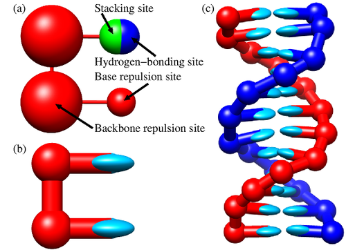

::: {.callout-tip appearance="simple"}
## Learning outcomes

1.  Explain why entropy and thermal fluctuations, and not only energy, control the behaviour of soft matter, whose interaction energies are of the order of $k_BT$.
2.  Explain the idea of coarse-graining, and why very different microscopic constituents can share similar macroscopic behaviour.
3.  Recognise the main classes of soft and disordered systems studied in this course.
:::

Most of the matter around us does not simply fit within the idealized pictures of crystalline solids or simple liquids: examples include colloids, polymers, surfactants, liquid crystals, foams, gels, and biological materials such as proteins, DNA, and cell membranes.

As Philip Anderson put it in a famous essay, *more is different* [@anderson1972more]: when many simple units interact, collective properties emerge that cannot be understood by studying the individual components alone.

This means that cellular **life itself** (the very constituents that make us) obeys principles that go beyond the standard patterns of conventional solid-state physics.

This branch of physics is called **soft condensed matter physics**, or **macromolecular** physics, or the physics of **complex fluids**. Specifically, *soft matter* refers to an area of condensed matter focused on systems that can be *easily deformed*. 

In this course, we will emphasize the fact that many such systems are not crystalline: thermal noise and disordered configurations play a key role in their phase behavior, and hence we think of them as **complex disordered systems**.

While we often think about problems in physics as a matter of energy minimization, in soft-matter physics a key role is played by **fluctuations**. Typically (but not exclusively) these are **thermal fluctuations**. This means that **entropy** and not only the energy from the interactions plays a key role.

::: {.column-margin} 
::: {.content-visible when-format="live-html"}

{fig-align="left"}
:::
:::

This is because soft matter systems are typically composed of **many microscopic constituents** in contact with an **environment**. The appropriate description of the **macroscopic state** of such systems is therefore **statistical** and uses the language of **statistical mechanics**. The relevant **energy**, therefore, is the free energy of the statistical ensemble representative of the system under consideration. For example, in the canonical ensemble, this is the Helmholtz free energy

$$F = U-TS$$

where $U$ is the internal energy, $T$ the temperature and $S$ is the entropy of the system. Therefore, in a broader sense, soft matter is the physics of those systems for which the internal energy and the entropy are on comparable scales.

Per particle, the free energy reads $f = u - Ts$. The entropy approximately counts the number of arrangements per particle, $s = \dfrac{k_B}{N}\ln\Omega$: for hundreds of arrangements per particle one has $s = O(1)\,k_B$, so that the entropic term $Ts$ is of the order of $k_BT$.

In other words, **fluctuations of the internal energy** per constituent are on the same scale as **thermal fluctuations**:

$$\Delta u \sim k_BT $$

where $k_B$ is the Boltzmann constant and $\Delta u$ indicates standard deviations from the average internal energy per constituent.


::: {.callout-note collapse="true"}
# The Physics of Entropy

Soft matter physics is fundamentally the physics of **entropy**. Unlike traditional systems where interaction energy minimization dominates, in soft matter, entropy plays a crucial role in determining the structure, dynamics, and behaviour of the system. The interplay between entropy and intermolecular energy leads to the rich and diverse phenomena observed in soft matter systems.
:::


## Systems and definitions

### Elementary constituents and energy scales

Soft matter covers a wide spectrum of deformable systems. Each is constituted of many parts. Each is deformable because the interactions amongst such parts are **weak** compared to the perturbing forces (e.g. thermal fluctuations or mechanical loading).

In hard condensed matter, the elementary constituents are the atoms themselves, eventually with their subatomic particles. Between atoms, the scale of the interaction energies is in the 0.1 to 10 eV: for example the carbon-carbon covalent bond is approximately 3.6  eV. 

The main units of soft matter are not atoms. They are instead themselves aggregates of atoms such as:

- **colloids**, micrometer- to nanometer-sized particles dispersed in a fluid.
- **polymers**, macromolecules composed of long chains such as DNA, proteins, plastics
- **surfactants**, molecules with polar head and tails that lead to the spontaneous formation of structures such as bilayers (e.g. the cellular membrane).  

Amongst such units, the dominating forces of soft matter are much weaker than in hard condensed matter:

- Van der Waals interaction energies are of the order of 0.001-0.01 eV 
- weak interactions such as hydrogen-bonds are typically in the 0.01-0.2 eV range
- the thermal energy at room temperature is $k_B T \approx 0.025 eV$ (check it for yourself)

At the **microscopic** level, all these interactions have essentially one source: the electrostatic force. However, this information is practically of no use when we want to understand how the units of soft matter come together to give rise to **macroscopic** properties of soft matter systems, such as their elastic properties, their viscosities, their plasticity. In fact, the emphasis on the atomistic details of the various units is fundamentally misleading: atomistically very different objects (e.g. colloids and micelles) can in fact share very similar macroscopic behaviours.

Therefore, theories of soft matter leverage the concept of **coarse-graining**, rooted in the [renormalisation group](../phase-transitions/rg.qmd) notions explored earlier. Coarse-graining means integrating out the unimportant degrees of freedom and only describing the units in terms of a few important parameters. For example, instead of taking a full atomistic representation of the DNA we may want to focus on the fact that structurally it is a long chain with specific bending energies: we may want to include the fact that it is formed by a double helix but we may not want to specifically construct every single atom in the sugar chain that forms the backbone. An example of DNA coarse graining is provided by the successful model [oxDNA](https://dna.physics.ox.ac.uk/index.php/Main_Page) (see picture below):




::: {.callout-note collapse="true"}
# Coarse graining
Coarse graining is often motivated by intuition, experimental insights or a simple desire of simplification. It allows for a multi-scale description of the problem which permits to describe large systems and long time scales.

Nonetheless, coarse-graining can also be made mathematically rigorous. For example, rigorous coarse graining in statistical mechanics can be performed by projecting the dynamics onto a relevant and an irrelevant (fluctuating) part, in the so called [**Mori-Zwanzig** formalism](https://en.wikipedia.org/wiki/Mori-Zwanzig_formalism) [@mori1965].
:::

### Classes of systems

In our exploration of soft matter we will focus on five main classes of systems which display different physics:

- [colloidal dispersions](soft-matter_colloids.qmd)
- [polymeric systems](soft-matter_polymers.qmd)
- [liquid crystals](soft-matter_liquidcrystals.qmd)
<!-- - surfactant aggregates -->
- [arrested systems](soft-matter_glasses.qmd)
- [active matter](soft-matter_active.qmd)

#### Colloidal dispersions {.unnumbered}

Colloidal dispersions are systems where small particles, typically in the nanometer to micrometer range, are dispersed in a continuous medium (a solvent). Prototypical colloids are **spherical** particles of various sizes (e.g. as those present in paint) but colloidal science has achieved a high degree of sophistication, with colloidal particles with various different shapes and interactions.

Colloids are often thought as **big atoms**: they exhibit Brownian motion, can form ordered structures (colloidal crystals), and display phase transitions similar to atomic systems. However, their larger size and slower dynamics make them ideal for studying phenomena that are difficult to observe in atomic systems. 

#### Polymeric systems {.unnumbered}

Polymer physics is a field on its own. Polymers are macromolecules composed of repeating structural units (monomers) connected by covalent bonds. Their unique properties arise from their string-like structure and the interplay between entropic and energetic contributions.

Polymers can be classified into two main categories:

- **Synthetic polymers**, including plastics (e.g., polyethylene, polystyrene) and synthetic rubbers.
- **Biopolymers**, such as polymers like DNA, RNA, and proteins.


```{python} 
#| fig-cap: "*3D Rendering of the bio-polymer synuclein as extracted from the [RCSB Protein Data Bank](https://www.rcsb.org) (click to rotate)*"

import py3Dmol #install this with: pip install py3dmol

pdb_id = "1XQ8"  # Human micelle-bound alpha-synuclein, an analog of long polymers 
# Fetch the PDB structure from the RCSB PDB server
view = py3Dmol.view(query='pdb:' + pdb_id)
# Customize visualization (you can change the style or the color)
view.setStyle({}, {'sphere': {'color': 'spectrum'}});
view.setBackgroundColor('white')  # Set background color to white
view.show()
```


Compared to colloids, polymers have distinctive characteristics common to all chain-like molecules, such as their topological constraints due to the fact that two polymers cannot cross each other (a phenomenon known as *polymer entanglement*).

#### Liquid crystals {.unnumbered}

When we take soft matter units that are highly anisotropic (e.g. elongate in particular directions) thermal fluctuations and high packing lead to equilibrium states with a degree of order that is intermediate between the complete disorder of a liquid and the long-ranged, three-dimensional order of a crystal. 

Such states are referred to as **liquid crystal** and can be described successfully with continuum free energy theories that take into account the symmetries of the order parameters.

Components that form liquid crystals are called **mesogens** and  include highly anisotropic organic macromolecules (as used in liquid crystal displays), rod-like molecules or polymeric aggregates, as well as disk-shaped molecules and particles(such as triphenylene and derivatives).

<!--
#### Surfactant aggregates {.unnumbered}

When two distinct fluid phases are put into contact, a free energy cost per unit area ensues: this is the surface tension. It is possible to control the tension by introducing molecules that sit at the interface between the two phases, called **surfactants**.

Hence, surfactants are molecules which contain chemical groups with different affinities (they are **amphiphilic**). A key example is the case of phospholipids, which possess both hydrophilic (water-preferring) heads and hydrophobic (water avoiding) tails. As surfactants sit at interfaces they separate different fluid phases; above a critical concentration they also **self-assemble** in the bulk, forming equilibrium bilayers and vesicles that are ubiquitous in cell biology.
-->

#### Arrested systems {.unnumbered}

We have stressed that the thermal energy is distinctive of soft matter systems. It would be then natural to assume that as we reduce the temperature, we should converge readily to the solid state physics of crystalline solids. In fact, on the way to low temperatures, the lack of long-range order of most soft-matter systems has important consequences: many such systems find themselves trapped in states that are not corresponding to the global energy minimum (i.e. the crystal) and instead display non trivial mechanisms of structural relaxation. These systems are disordered a bit like liquids, but share various mechanical properties, such as emergent rigidity, elasticity and plasticity. 

Examples of arrested systems include:

- **Glasses**, such as silica glass or metallic glasses, where the system is kinetically trapped in a disordered state.
- **Gels**, which are networks of interconnected particles or polymers that span the entire system, providing rigidity despite being mostly liquid.

These systems are arrested as their relaxation towards equilibrium is so slow that it is longer than any observable timescales. This makes them fundamentally **out-of-equilibrium** systems, escaping from an ordinary description in terms of equilibrium statistical mechanics.


#### Active matter {.unnumbered}

Active matter refers to systems composed of units that consume energy to generate motion or mechanical stresses. Unlike passive systems, active matter is inherently out of equilibrium due to the continuous energy input at the microscopic level. Examples include:

- **Biological systems**, such as bacterial colonies, cell tissues, and flocks of birds.
- **Synthetic systems**, like self-propelled colloids or active gels.

The study of active matter focuses on understanding how individual activity leads to emergent collective behaviors, such as swarming, clustering, or pattern formation, often described using hydrodynamic theories or agent-based models.
