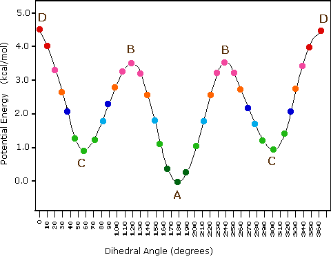
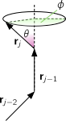
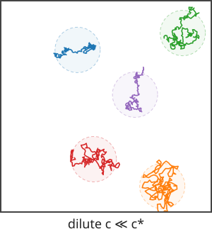
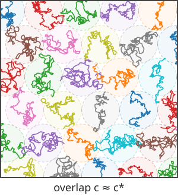

```{pyodide}
#| echo: false
#| autorun: true
# modifying the path to add the code folder
import sys
sys.path.insert(0, 'src')
```

::: {.callout-tip appearance="simple"}
## Learning outcomes

1.  Link the mathematics of random walks to the structure of single, idealised polymer chains (end-to-end distance, radius of gyration, $\langle R^2\rangle\propto N$).
2.  Introduce stiffness, excluded-volume interactions and solvent quality, and see how they change the size of a chain, $R\sim N^\nu$.
3.  Identify the concentration regimes of polymer solutions (dilute, semi-dilute, concentrated) from the overlap concentration $c^*$, and the main classes of bulk polymers.
:::

## General molecular properties

A polymer is a **large molecule** made up of many small, simple chemical units, joined together by chemical bonds. The basic unit of this sequence is called a **monomer**, and the number of units in the sequence is called the **degree of polymerisation**. 

It is possible to have polymers containing over $10^{5}$ units and there are naturally occurring polymers with a degree of polymerisation exceeding $10^{9}$. For example, polystyrene with a degree of polymerisation of $10^{5}$ has a molecular weight of about $10^{7} \mathrm{~g} / \mathrm{mol}$ and, if fully stretched out, would be about 25 $\mu \mathrm{m}$ long.


Polymers play a central role in many fields, ranging from technology to biology. This is reflected in a huge number of different chemical structures. Given this manifold and the complexity of polymer molecules, the theories are astonishingly simple. This is possible because of the characteristic feature of polymers: The molecule itself is **very large** (compared to the individual units) and the macroscopic behaviour is dominated by this large-scale property of the molecule. Theories focus on such *large-scale* properties, whereas the small scale *fine structure* is typically resolved by computer simulations.


Polymers exist in very different architectures, such as 

- **linear**: straight chains of repeating units (e.g., polyethylene).

- **branched**: polymers with a main chain and side chains (branches) attached. The branching affects properties like density and melting point (e.g., low-density polyethylene).

- **star**: polymers with multiple linear chains (arms) radiating from a central core. These structures can have unique properties like lower viscosity.

- **cross-linked**: polymers where chains are interconnected by covalent bonds, forming a network. This structure makes them rigid and heat-resistant (e.g., vulcanized rubber).

Furthermore, a large variation in the chemical structure may be achieved by combining different monomers (**copolymerisation**). 

For simplicity, we will focus on **linear homopolymers**, i.e. with no branch points and with all identical subunits.


### Example structures

Here below you can see the chemical structures of (sections) of a few common polymers. Hovering on the diagram should highlight the repeated units.


::: {.callout-note collapse="true"}
# How to use the visualisers
Click on the 🔧 symbol to customise the visualisation:

- you should see a **State Tree** to your left
- click on the last item (highlighted in light blue, by default *Ball & Stick*)
- click on *Update 3D representation* and select a suitable *Type*. For example the **Cartoon** mode will correspond to the kind of coarse graining we will have in mind when talking about polymer chains.
:::

#### Polystyrene  $\rm (C_8H_8)_n$ {.unnumbered}




#### Poly(methyl methacrylate) (PMMA) $\rm (C_5H_8O_2)_n$ {.unnumbered}

This polymer is also known as acrylic, acrylic glass, or plexiglass. This is a very common material also to fabricate colloids (PMMA particles).



#### Natural rubber $\rm (C_5H_8)_n$ {.unnumbered}




## Models for the conformation of polymers

In order to understand the properties of most substances, we must consider a large assembly of molecules. In the case of polymers, however, the molecules themselves are very large and due to their flexibility they can take up an enormous number of configurations by rotation of chemical bonds. The shape of the polymer can therefore only be usefully described **statistically** and one need to use statistical mechanics to calculate the characteristics of even an isolated polymer. 

To be able to investigate the properties of a **single polymer** and to neglect interactions between polymers, the polymer is placed in a very **dilute solution**. In this chapter, we will theoretically investigate the properties of an isolated, single polymer chain in solution (which in addition is linear and consists of only one kind of monomers).


### Freely-jointed chain

Many polymers are highly flexible and are coiled up in solution. In a simple model we thus describe a polymer with two assumptions :

- it is composed of a **large number of segments** freely joined up
- all angles between segments are assumed to be **equally likely**.

The monomers are located at positions $\mathbf{R}_{\mathrm{j}}$ and connected by bonds $\mathbf{r}_{j}=\mathbf{R}_{j}-\mathbf{R}_{j-1}$ of length $\left|\mathbf{r}_{j}\right|=b_{0}$.

The **end-to-end vector** $\mathbf{R}$ is then simply the vector linking the head to the tail of the chain:

$$\mathbf{R} = \mathbf{r}_1+\mathbf{r}_2+\dots+\mathbf{r}_N = \sum_{j=1}^N \mathbf{r}_j.$$


At any instant, the configuration (arrangement) of the polymer is one realisation of an N-step random walk in three dimensions.

```{pyodide}
#| autorun: true
#| caption: "Example of freely-jointed chain as a random walk in 3d"

import numpy as np

# Play with the parameters (e.g. large and small N) and explore different conformations in 3D
# The color coding only maps the index of the monomer in the chain
def generate_free_polymer(N=100, b=1):
    # Generate random walk in 3D
    theta = np.arccos(2 * np.random.rand(N) - 1)  # polar angle
    phi = 2 * np.pi * np.random.rand(N)           # azimuthal angle

    dx = b * np.sin(theta) * np.cos(phi)
    dy = b * np.sin(theta) * np.sin(phi)
    dz = b * np.cos(theta)

    x = np.concatenate([[0], np.cumsum(dx)])
    y = np.concatenate([[0], np.cumsum(dy)])
    z = np.concatenate([[0], np.cumsum(dz)])
    return x,y,z

# custom plotting
import sys

sys.path.append("./src")
import plotting
N, b = 100, 1
# Plot the end-to-end vector as a red arrow

x, y, z = generate_free_polymer(N, b)
fig = plotting.plotly_3d(x, y, z, name=f"{N}-step polymer")
fig = plotting.plot_vector([x[0],x[-1]],[y[0],y[-1]],[z[0],z[-1]],fig, name="end-to-end vector")
# ensure plotting works by encapsulating it in HTML
from IPython.display import HTML
HTML(fig.to_html(include_plotlyjs="cdn"))
```


#### End-to-end vector {.unnumbered}

 In time, the various segments undergo Brownian motion and the polymer fluctuates between all possible configurations of the random walk. Remember however that it does this with fixed inter-monomer distance.

The mean squared end-to-end distance is then simply 
$$\begin{aligned}\langle\mathbf{R}^2\rangle &= \left\langle \left( \sum_{i=1}^N \mathbf{r}_i\right) \cdot  \left( \sum_{j=1}^N \mathbf{r}_j\right) \right\rangle\\
&= \left\langle \sum_{i=1}^N \sum_{j=1}^N  \mathbf{r}_i \cdot \mathbf{r}_j \right\rangle\\
\end{aligned}$$
We can split the sum into the terms where $i=j$ and the rest. This yields in general


$$\langle \mathbf{R}^2\rangle = Nb_0^2+\sum_{i\neq j}\langle \mathbf{r}_i \cdot \mathbf{r}_j  \rangle$$

where the second term simply encodes the covariances between the (random) variables $\mathbf{r}_i,\mathbf{r}_j$. Since we assumed (in this simplistic case) that they are independent, only the first term remains for the free-jointed chain


$$\langle \mathbf{R}^2\rangle = Nb_0^2$$

This is essentially the same result as for the [mean squared displacement of a random walk](../phase-transitions/Brownian-and-Langevin-dynamics.qmd#mean-square-displacement), provided that we recognise that the number of monomers has taken the role played by time in the case of the walk. We had ${\rm MSD}\propto t$ and here we have

$$\langle \mathbf{R}^2\rangle\propto N$$

Since we formally inherit all the results holding for a random walk, we can also predict what happens to the distribution of possible end-to-end distances in the limit of long polymers, i.e. large $N$. 

The mean squared end-to-end distance can be decomposed as 

$$
\left\langle\mathbf{R}^2\right\rangle=\left\langle R_x^2\right\rangle+\left\langle R_y^2\right\rangle+\left\langle R_z^2\right\rangle=3 \sigma^2=N b_0^2 \Rightarrow \sigma^2=\frac{N b_0^2}{3}
$$
where $\sigma^2$ is the variance per component.

We know that the random walk [converges to a Gaussian distribution](../phase-transitions/master-equation-and-diffusion.qmd#from-the-master-equation-to-the-diffusion-equation) in 3d with each component having variance $\sigma^2$. Thus, for large $N$, the probability distribution for the end-to-end vector $\mathbf{R}$ is
$$
P(\mathbf{R}) = \left( \frac{3}{2\pi N b_0^2} \right)^{3/2} \exp\left( -\frac{3 \mathbf{R}^2}{2 N b_0^2} \right)
$$

This means that, for long chains, the end-to-end distance is distributed as a 3D Gaussian, centered at zero, with variance proportional to $N$.

#### Radius of gyration {.unnumbered}

While the end-to-end distance represents a well-defined quantity for a linear chain, we need a more versatile measure of the size for more complicated architectures, such as branched or star-shaped polymers. This is provided by the so called **radius of gyration**, a measure of the (average) extent of the polymer chain.

The radius of gyration is a generic quantity that can be measured from any point cloud. It is closely linked to the (co)-variance of the set of points.

We define the **center of mass** as the average position

$$\mathbf{R}_{\rm CM}=\frac{1}{N} \sum_{j=1}^{N} \mathbf{R}_{j}$$


A general way to describe the spatial extent and shape of the polymer is to construct the **gyration tensor** (also called the configuration tensor):

$$
\mathbf{S} = \frac{1}{N} \sum_{j=1}^N (\mathbf{R}_j - \mathbf{R}_{\rm CM}) \otimes (\mathbf{R}_j - \mathbf{R}_{\rm CM})
$$

where $\otimes$ denotes the outer product, and $\mathbf{S}$ is a $3 \times 3$ symmetric matrix. The elements of $\mathbf{S}$ are given by

$$
S_{\alpha\beta} = \frac{1}{N} \sum_{j=1}^N (R_{j,\alpha} - R_{{\rm CM},\alpha})(R_{j,\beta} - R_{{\rm CM},\beta})
$$

where $\alpha, \beta \in \{x, y, z\}$.

The **radius of gyration squared** is then simply the trace of this tensor:

$$
R_g^2 = \mathrm{Tr}(\mathbf{S}) = S_{xx} + S_{yy} + S_{zz}
$$

The eigenvalues and eigenvectors of $\mathbf{S}$ provide information about the principal axes and shape anisotropy of the polymer coil. The **tensor of gyration** corresponds to the **covariance matrix** of the positions $\mathbf{R}_j$.

For the ideal chain, the mean squared radius of gyration is directly proportional to the mean squared end-to-end distance.

<div style="border: 2px solid red; padding: 1em; border-radius: 8px; background-color: transparent;">
$$
\langle R_g^2 \rangle = \frac{1}{6} \langle R^2 \rangle
$$
</div>


::: {.callout-note collapse="true"}
# Proof

The radius of gyrations is $$
R_g^2=\frac{1}{N} \sum_{j=1}^N\left(\mathbf{R}_j-\mathbf{R}_G\right)^2
$$

We can rewrite it as 
$$
R_g^2 = \frac{1}{2N^2} \sum_{j=1}^N \sum_{k=1}^N (\mathbf{R}_j - \mathbf{R}_k)^2
$$

and note that, from our previous result on the end-to-end distance, the mean squared distance between monomers $j$ and $k$ in a free jointed chain is
$$
\langle (\mathbf{R}_j - \mathbf{R}_k)^2 \rangle = |j - k| b_0^2
$$

So,
$$
\langle R_g^2 \rangle = \frac{b_0^2}{2N^2} \sum_{j=1}^N \sum_{k=1}^N |j - k|
$$

Evaluating the double sum gives:
$$
\sum_{j=1}^N \sum_{k=1}^N |j - k| = \frac{N^3 - N}{3}
$$

Thus,
$$
\langle R_g^2 \rangle = \frac{b_0^2}{2N^2} \cdot \frac{N^3 - N}{3} = \frac{b_0^2}{6} (N - \frac{1}{N})
$$

For large $N \gg 1$:
$$
\langle R_g^2 \rangle \approx \frac{1}{6} N b_0^2
$$
:::


### Freely-rotating chain

In a polymer molecule the bond angles are usually restricted, which leads to a limited flexibility of the molecule.
Let us consider the case of $n$-butane:

$$
\mathrm{H}_{3} \mathrm{C}-\mathrm{CH}_{2}-\mathrm{CH}_{2}-\mathrm{CH}_{3}
$$


##### N-butane {.unnumbered}




The **valence angle** (also called the bond angle) is the angle formed between two adjacent chemical bonds originating from the same atom. In the context of polymers, it is the angle between two consecutive bonds along the polymer backbone. The value of the valence angle is determined by the chemical structure of the monomer and affects the flexibility and overall conformation of the polymer chain. For example, in $n$-butane, the C–C–C bond angle is about $112^\circ$. Still rotations about the C-C bond are possible.

/Chirality/Stereoisomers/Butane_Conformers)](figs/butconf.png)


Indeed, the potential energy of a polymer configuration depends on the dihedral angle.



At low temperatures ( $k_{B} T < {\mathrm {\text{configurational energy}}}$) the configuration will thus be predominantly of type **A** (an anti conformation). As the temperature is increased ( $k_{B} T \sim$ config. energy), there will also be **C** (gauche) configurations and at high temperatures ( $k_{B} T \gg$ config. energy), any angle will be possible. 

This suggests that a good model of polymeric conformation can take fixed angles between bonds, but needs to include **free rotation** *about* the bonds. This model is called the **freely-rotating chain**.


::: {style="float: right; margin: 10px;"}
{width=250px}
:::

We start with a fixed configuration of $\mathbf{r}_{l}$, $\mathbf{r}_{2}, \ldots, \mathbf{r}_{j-1}$ and then add the next segment $\mathbf{r}_{j}$. While the angle $\theta$ between consecutive bond vectors (i.e. $\pi$ minus the valence angle) is given by the chemistry of the molecule, the segment can still freely rotate about the axis defined by $r_{j-1}$, i.e. $\varphi$ can take any value $0 \leq \varphi \leq 2 \pi$. If we average $\mathbf{r}_{j}$ over $\varphi$, while keeping $\mathbf{r}_{1}, \mathbf{r}_{2}, \ldots, \mathbf{r}_{j-1}$ fixed, only the component in $\mathbf{r}_{j}$ direction remains:

$$\langle \mathbf{r}_{j} \rangle_{\mathbf{r}, \mathbf{r}_{2}, \ldots, \mathbf{r}_{j-1}\quad {\rm fixed}}=\cos \theta \mathbf{r}_{j-1}$$


Multiplying both sides by $\mathbf{r}_k$ and averaging over all configurations gives

$$
\left\langle\mathbf{r}_j \cdot \mathbf{r}_k\right\rangle=\cos \theta\left\langle\mathbf{r}_{j-1} \cdot \mathbf{r}_k\right\rangle .
$$

Applying this relation recursively leads to

$$
\left\langle\mathbf{r}_j \cdot \mathbf{r}_k\right\rangle=b_0^2(\cos \theta)^{|j-k|}
$$

Since $\cos \theta<1$, correlations between $\mathbf{r}_{j}$ and $\mathbf{r}_{k}$ decrease with increasing distance $|j-k|$ between the links and the orientations of distant links become uncorrelated.

The end-to-end distance $\left\langle R^{2}\right\rangle$ of a freely-rotating chain is hence
$$
\begin{aligned}
\left\langle R^{2}\right\rangle & =\sum_{j=1}^{N} \sum_{k=1}^{N}\left\langle\mathbf{r}_{j} \cdot \mathbf{r}_{k}\right\rangle=b_{0}^{2} \sum_{j=1}^{N} \sum_{k=1}^{N}\cos^{|j-k|} \theta=N b_{0}^{2}+2 b_{0}^{2} \sum_{j=1}^{N} \sum_{k=1}^{j-1} \cos ^{(j-k)} \theta \\
& =N b_{0}^{2}+2 b_{0}^{2} \sum_{j=1}^{N} \cos ^{j} \theta \sum_{k=1}^{j-1} \cos ^{-k} \theta
\end{aligned}
$$

where we used the same argument as above to deal with $|j-k|$. To calculate these two sums we consider the geometric progression:

$$
\begin{aligned}
& S=\sum_{m=1}^{M} x^{m}=x+x^{2}+\ldots .+x^{M} \quad \therefore x S=x^{2}+x^{3}+\ldots .+x^{M+1} \quad \therefore S-x S=x-x^{M+1} \\
& \therefore S=\frac{x-x^{M+1}}{1-x}
\end{aligned}
$$

With the help of this formula we get

$$
\begin{aligned}
\left\langle R^{2}\right\rangle & =N b_{0}^{2}+2 b_{0}^{2} \sum_{j=1}^{N} \cos ^{j} \theta \frac{\frac{1}{\cos \theta}-\frac{1}{\cos ^{j} \theta}}{1-\frac{1}{\cos \theta}}=N b_{0}^{2}+\frac{2 b_{0}^{2}}{\cos \theta-1}\left(\sum_{j=1}^{N} \cos ^{j} \theta-\sum_{j=1}^{N} \cos \theta\right) \\
& =N b_{0}^{2}+\frac{2 b_{0}^{2}}{\cos \theta-1}\left(\frac{\cos \theta-\cos ^{N+1} \theta}{1-\cos \theta}-N \cos \theta\right)
\end{aligned}
$$

For large N this can be simplified

$$\left\langle R^{2}\right\rangle \approx N b_{0}^{2}+\frac{2 b_{0}^{2}}{1-\cos \theta} N \cos \theta=N b_{0}^{2}\left(\frac{1+\cos \theta}{1-\cos \theta}\right)=C N b_{0}^{2}$$

with $C=(1+\cos \theta) /(1-\cos \theta)$.


 To get a better idea of the effect of a fixed angle $\theta$, i.e. going from a freely-jointed to a freely-rotating chain, we look at two limiting cases:

1. $\theta \rightarrow 0 \Rightarrow \cos \theta \rightarrow 1-\frac{\theta^{2}}{2} \Rightarrow C=\frac{2-\theta^{2} / 2}{\theta^{2} / 2} \approx \frac{4}{\theta^{2}} \quad\left(\mathrm{C} \approx 500\right.$ for $\left.\theta=5^{0}\right)$

<div style="border: 2px solid blue; padding: 1em; border-radius: 8px; background-color: transparent;">

$$
\therefore\left\langle R^{2}\right\rangle \gg N b_{0}^{2}
$$
</div> 

This corresponds to a nearly straight chain, i.e., a rigid rod. The end-to-end distance is much larger than that of a flexible chain with the same number of segments. (The large-$N$ result assumes $N \gg C$; a shorter chain is simply a rod, with $R \approx N b_0$.)

```{python}
#| echo: false
import numpy as np
import sys

sys.path.append("./src")
import plotting
# Parameters for a nearly straight chain (rigid rod)
N = 1000
b0 = 1
theta_deg = 0.001  # very small angle
theta = np.deg2rad(theta_deg)

# Generate coordinates for a rigid rod with small bond angle
x = [0]
y = [0]
z = [0]
direction = np.array([1, 0, 0])
for i in range(N):
    # Rotate direction by a small angle theta around a random axis perpendicular to direction
    axis = np.random.randn(3)
    axis -= axis.dot(direction) * direction / np.linalg.norm(direction)**2
    axis /= np.linalg.norm(axis)
    # Rodrigues' rotation formula
    direction = (direction * np.cos(theta) +
                 np.cross(axis, direction) * np.sin(theta) +
                 axis * np.dot(axis, direction) * (1 - np.cos(theta)))
    direction /= np.linalg.norm(direction)
    new_point = np.array([x[-1], y[-1], z[-1]]) + b0 * direction
    x.append(new_point[0])
    y.append(new_point[1])
    z.append(new_point[2])

fig = plotting.plotly_3d(x, y, z, name="Rigid rod-like chain")
fig = plotting.plot_vector([x[0], x[-1]], [y[0], y[-1]], [z[0], z[-1]], fig, name="end-to-end vector")
fig.show()
```

2. $\theta = \pi / 2 \Rightarrow \cos \theta = 0 \Rightarrow C=1$
<div style="border: 2px solid blue; padding: 1em; border-radius: 8px; background-color: transparent;">$$
\therefore\left\langle R^{2}\right\rangle=N b_{0}^{2}$$</div>

These are ideal conditions, where the random walk model of the free-jointed chain works exactly.

Real chains sit in between: a C–C–C valence angle of about $112^\circ$ corresponds to an angle $\theta \approx 68^\circ$ between consecutive bond vectors, giving $C \approx 2$.

::: {.callout-note collapse="true"}
# Question: what about $\theta \to \pi$?

What happens to $C$ as $\theta \to \pi$? Sketch the chain. Is this limit physical?

**Answer.** Writing $\theta = \pi - \delta$, we have $\cos\theta \approx -1 + \delta^2/2$ and $C \approx \delta^2/4 \to 0$, so the formula predicts $\langle R^2\rangle \ll N b_0^2$. Each bond points almost straight back along the previous one: the chain folds onto itself, and monomer $j+1$ sits on top of monomer $j-1$. Excluded volume (next section) forbids this, so the limit is unphysical. It is also *not* a collapsed globule: the chain is still a random walk, $\langle R^2\rangle \propto N$, only with a tiny prefactor. Real collapse requires attraction between monomers, i.e. a poor solvent (see below).
:::

Again, we get $\left\langle R^{2}\right\rangle \propto N$, which suggests that a generic long freely-rotating chain can be represented by an *effective* freely-jointed chain with $N'$ segments of length $b$. 

::: column-margin
This is another example of **coarse-graining** (see the [introduction](soft-matter_intro.qmd#coarse-graining)).
:::


Real and effective chain must have the same actual length, i.e.
$$
N b_0 = N' b
$$
and the same end-to-end distance,
$$
C N b_0^2 = N' b^2.
$$
Solving these two equations gives $b = C b_0$ and $N' = N / C$. This has important consequences:

- All sufficiently long flexible chains have identical  behaviour as regards their dimensions: the chemical details are hidden in $N^{\prime}$ and $b.$ 
- While individual monomer pairs are not totally flexible, groups of monomers are
- $C$ represents the number of monomers over which the orientational correlation is lost
- $b$ is the so called **"Kuhn" statistical segment length** and defines a related characteristic known as the "persistence length" $l_{p}=b/2$, also calculated directly via the correlation of bond vectors along the chain:
$$
\langle \mathbf{r}_i \cdot \mathbf{r}_{i+n} \rangle = b_0^2 \, \langle \cos \theta \rangle^n = b_0^2 \, e^{-n b_0 / l_p}
$$
where $b_0$ is the bond length, $\theta$ is the angle between consecutive bonds, and $n$ is the number of bonds separating the two segments.

For the freely-rotating chain,
$$
l_p = -\frac{b_0}{\ln \langle \cos \theta \rangle}
$$

For small angles, this simplifies to $l_p \approx \frac{b_0}{1 - \langle \cos \theta \rangle}$.

```{python}
#| echo: false
import numpy as np
import sys

sys.path.append("./src")
import plotting

# Parameters for real chain
N = 200
b0 = 1.0
theta_deg = 70 
theta = np.deg2rad(theta_deg)

# Generate a freely-rotating chain
x = [0]
y = [0]
z = [0]
direction = np.array([1, 0, 0])
dirs = [direction.copy()]
for i in range(N):
    # Random rotation about previous bond
    phi = np.random.uniform(0, 2 * np.pi)
    # Build orthonormal basis
    if np.allclose(direction, [0, 0, 1]):
        perp = np.array([1, 0, 0])
    else:
        perp = np.cross(direction, [0, 0, 1]).astype(float)
        perp /= np.linalg.norm(perp)
    # Rodrigues' rotation formula for theta about perp
    dir_theta = (direction * np.cos(theta) +
                 np.cross(perp, direction) * np.sin(theta) +
                 perp * np.dot(perp, direction) * (1 - np.cos(theta)))
    # Now rotate dir_theta by phi about direction
    k = direction / np.linalg.norm(direction)  # rotation axis
    v = dir_theta  # vector to rotate
    dir_new = (v * np.cos(phi) +
            np.cross(k, v) * np.sin(phi) +
            k * np.dot(k, v) * (1 - np.cos(phi)))
    dir_new /= np.linalg.norm(dir_new)
    new_point = np.array([x[-1], y[-1], z[-1]]) + b0 * dir_new
    x.append(new_point[0])
    y.append(new_point[1])
    z.append(new_point[2])
    direction = dir_new
    dirs.append(direction.copy())

# Calculate effective Kuhn segment length and number of segments
C = (1 + np.cos(theta)) / (1 - np.cos(theta))
b_kuhn = C * b0
N_kuhn = int(N / C)

# Interpolate the original chain to get the effective Kuhn chain
# Original bonds (vectors between points)
bonds = np.diff(np.array([x, y, z]), axis=1)  # shape (3, N)

chunk_size = int(np.floor(C))
N_kuhn = N // chunk_size
remainder = N % chunk_size

xk = [0]
yk = [0]
zk = [0]

for i in range(N_kuhn):
    chunk_bonds = bonds[:, i*chunk_size:(i+1)*chunk_size]
    kuhn_bond = np.sum(chunk_bonds, axis=1)
    new_point = np.array([xk[-1], yk[-1], zk[-1]]) + kuhn_bond
    xk.append(new_point[0])
    yk.append(new_point[1])
    zk.append(new_point[2])

# Add leftover bonds as last segment if any
if remainder > 0:
    chunk_bonds = bonds[:, N_kuhn*chunk_size:]
    kuhn_bond = np.sum(chunk_bonds, axis=1)
    new_point = np.array([xk[-1], yk[-1], zk[-1]]) + kuhn_bond
    xk.append(new_point[0])
    yk.append(new_point[1])
    zk.append(new_point[2])
# Original contour length
original_bonds = np.diff(np.array([x, y, z]), axis=1)  # shape (3, N)
original_lengths = np.linalg.norm(original_bonds, axis=0)
original_contour_length = np.sum(original_lengths)

# Coarse-grained contour length
kuhn_bonds = np.diff(np.array([xk, yk, zk]), axis=1)
kuhn_lengths = np.linalg.norm(kuhn_bonds, axis=0)
kuhn_contour_length = np.sum(kuhn_lengths)

print(f"Original contour length: {original_contour_length:.4f}")
print(f"Coarse-grained contour length: {kuhn_contour_length:.4f}")
fig = plotting.plotly_3d(x, y, z, name="Freely-rotating chain", line_color='blue')
fig = plotting.plotly_3d(xk, yk, zk, name="Effective freely-jointed chain", line_color='orange',fig=fig)
fig.show()
```
<!--  -->

::: column-margin
This visualisation doesn't strictly satisfy the equal length requirement we set out above, but satisfies the equal end-to-end vector for the sake of visualisation. The Kuhn length should be thought of as a *statistical* quantity and the coarse-grained chain as a polymer with the equivalent statistical properties to a chain of subunits of the original chain.
:::

### Excluded volume effects

The fact that two monomers **cannot occupy** the same space has consequences on different length scales.
 
 - On a local length scale this prevents neighbouring monomers from coming too close together. This effect is taken into account in terms of a **restricted bond-angles**, which prevent them from overlapping. 
 - Non-overlap, i.e. excluded volume, of **distant monomers** along the chain has also to be taken into account and can have surprisingly large effects.

To estimate the importance of this effect, we consider the fraction of coil volume actually occupied by monomers: 

$$\quad V_{N}=N V_{1} \sim N b^{3},$$

where $\mathrm{V}_{1}$ is the volume of a monomer. 

The overall volume occupied by the whole coil is

$$
V_{\text {coil }}=\frac{4 \pi}{3}\langle R_{g}^{2}\rangle^{3 / 2} \sim \frac{4 \pi}{3} N^{3 / 2} b^{3}
$$

$$\therefore \frac{V_{N}}{V_{\text {coil }}}=\frac{N b^{3}}{(4 \pi / 3) N^{3 / 2} b^{3}} \sim N^{-1 / 2}$$


This means that for $N=10^{4}$ monomers occupy only about $1 \%$ of the whole coil volume.

The overall chain size as estimated by the radius of gyration $\langle R_{g}^{2}\rangle^{1 / 2}$ is determined by the competition of two effects: 

 1. **Entropy** (and chain connectivity) favour a **compact chain** and avoid the more unlikely stretched configurations
 2. Repulsive **excluded volume** interactions want to **expand the chain** to avoid overlap. 
 
 Based on this balance we will estimate the effect of excluded volume in a very hand-waving way. (Due to a fortuitous cancellation of errors introduced by various approximations, the result is practically identical to more rigorous treatments, which are very involved.)

We consider the Helmholtz function of a single chain, which is regarded as an assembly of particles with constant volume $\mathrm{NV}_{1}$ at constant temperature T :

$$
F=U-T S
$$

The entropy S is given by

$$
S=k_{B} \ln (\text {number of configurations })
$$

where for a given end-to-end vector $\mathbf{R}$ the number of configurations is expected to be proportional to

$$
P(\mathbf{R})=\left(\frac{3}{2 \pi\langle R^{2}\rangle}\right)^{3 / 2} e^{-\frac{3 R^{2}}{2\langle R^{2}\rangle}}
$$

and hence

$$
S \sim \frac{-3 k_{B} R^{2}}{2 N b^{2}}+\text { terms indep. of } \mathrm{R}
$$

The internal energy $U$ includes the kinetic and potential energy. However, the kinetic energy is *independent of the configuration* and thus of $\mathbf{R}$ and we only have to consider the potential energy. 

To estimate the potential energy, we disregard the connectivity of the chain and calculate the interaction energy of a 'segment gas' confined in a volume $R^{3}$. The probability of a monomer to lie in this volume is given by the fraction of total coil volume occupied by monomers, which we estimated above to be $N V_{1} / R^{3}$

Thus the number of monomer-monomer contacts is $N^{2} V_{1} / R^{3} \sim N^{1 / 2}$. With an energy $\varepsilon$ of a monomer-monomer contact, the potential energy $U \sim \varepsilon N^{2} V_{1} / R^{3}$.
We thus obtain

$$
F=\frac{\varepsilon N^{2} V_{1}}{R^{3}}+\frac{3 k_{B} T R^{2}}{2 N b^{2}}+\text { terms indep. of } \mathrm{R}
$$

which can be minimized with respect to $R$, i.e. $d F / d R=0$, yielding

$$R^{5}=\frac{\varepsilon V_{1} b^{2}}{k_{B} T} N^{3} \sim \frac{\varepsilon}{k_{B} T} N^{3} b^{5}$$ 

$$ \therefore R \sim N^{3 / 5} b$$

Simulations give a very similar scaling, $\mathrm{R} \sim N^{0.588}$. The chain can no longer be modelled by a random walk, but has to be described by a **self-avoiding random walk**. The distribution of end-to-end distances is also not Gaussian. Note that the exponent $3/5$ here is an example of a critical exponent (though not in exactly the same sense that you saw when [studying magnets and fluids](../phase-transitions/scaling.qmd)). Inclusion of excluded volume effects changes the universality class of the scaling of the chain length and radius of gyration with $N$ compared to the Gaussian chains that we looked at previously. 

Although the difference between an exponent of 0.5 (as is characteristic for the freely jointed and freely-rotating chains, i.e. a random walk) and 0.6 (excluded volume chain, i.e. self-avoiding random walk) seems small, it has a large effect at large N . For example, for $N=10^{4}, R=N^{0.5} b=100 b$, while $R=N^{0.6} b=251 b$, which corresponds to a swelling of the chain by a factor of 2.5.

 

::: column-margin
This is an example of the importance of accurate scaling exponents and how they can impact our predictions.
:::

## Good, poor and theta solvents

So far we only considered monomer-monomer interactions, which we assumed to be purely repulsive, and neglected the influence of the solvent. 

However, the type of solvent has a great effect on the polymer size. If there is a high affinity with the solvent ('good solvent') the polymer swells, while it will shrink in a 'poor solvent'. 

Solvent affinity refers to how strongly the solvent molecules interact with the polymer (or monomer) molecules compared to how they interact with themselves or with other monomers. Mathematically, this is captured by the interaction energy $\varepsilon_{sp}$ (solvent-monomer), compared to the average of solvent-solvent ($\varepsilon_{ss}$) and monomer-monomer ($\varepsilon_{pp}$) interactions. 

We consider a **lattice model**, where each lattice site has $z$ nearest neighbours and there are $N_{s}$ solvent molecules and $N_{p}$ monomers, with $\mathrm{N}_{\mathrm{sp}}$ solvent-monomer contacts.

The energies of interaction are 

- $\varepsilon_{s s}$ for the solvent-solvent 
- $\varepsilon_{\mathrm{pp}}$ for monomer-monomer 
-  $\varepsilon_{s p}$ for solvent-monomer interactions.

Then the energy of mixing $\Delta U_{\operatorname{mix}}$ is given by

$$
\Delta U_{\operatorname{mix}}=U-\left(U_{S}+U_{p}\right)
$$

where energy of pure solvent is $$U_{s}=\frac{z N_{s} \varepsilon_{s s}}{2}$$

and the energy of pure polymer is $$U_{p}=\frac{z N_{p} \varepsilon_{p p}}{2}$$

<!--  -->


resulting in an energy of solution 
$$U=N_{s p} \varepsilon_{s p}+\frac{\left(z N_{s}-N_{s p}\right) \varepsilon_{s s}}{2}+\frac{\left(z N_{p}-N_{s p}\right) \varepsilon_{p p}}{2}$$

Hence we obtain for the **energy of mixing**

$$
\Delta U_{\mathrm{mix}}=N_{s p}\left[\varepsilon_{s p}-\frac{1}{2}\left(\varepsilon_{s s}+\varepsilon_{p p}\right)\right]
$$

which can be either positive or negative:

- **Good solvent**: $\varepsilon_{s p}<\frac{1}{2}\left(\varepsilon_{s s}+\varepsilon_{p p}\right) \quad \therefore \Delta \mathrm{U}_{\text {mix }}<0$

<!--  -->

This is the case of a 'good solvent', because the monomers prefer to be near the solvent molecules. Excluded volume effects then expand the chain, which follows the self-avoiding walk scaling $R\sim N^{3/5}$ derived above.

- **Poor solvent**: $\varepsilon_{s p}>\frac{1}{2}\left(\varepsilon_{s s}+\varepsilon_{p p}\right) \quad \therefore \Delta \mathrm{U}_{\text {mix }}>0$

This is the case of a 'poor solvent', because the monomers prefer to be near to each other (and similarly for the solvent molecules). The attraction between the different monomers offset the excluded volume effect. If the attraction is strong enough, the chain collapses into a compact globule. Since the globule has a roughly uniform density, its volume grows linearly with the number of monomers, $R^3\propto N$, hence $R\sim N^{1/3}$. Examples include hydrophobic polypeptides (rich in e.g. alanine, leucine, methionine), polystyrene in water, and chromatin, packed into a compact globule in the cell nucleus.

The importance of the attractions generally depends on temperature. At very high temperatures the coil is expanded and the solvent quality is good. In contrast, at very low temperatures, the solvent quality is poor, attraction dominates, the coil collapses and phase separation is observed. In between these two limits, there is a temperature, the so-called theta temperature $\theta$, where the coil has ideal dimensions and the effects of excluded volume and attraction cancel each other: the chain behaves as a random walk, $R\sim N^{1/2}$. The solvent at $T=\theta$ is called a 'theta solvent'. The stronger the attractions the higher $\theta$ will be, while for weak attractions $\theta$ is low.
A full treatment of the coil expansion is rather involved and has to take into account excluded volume, attractions, configurational entropy and entropy of mixing. You can read more about the theta condition in @jones2002soft.


## Concentrated polymer solutions

Up to now we considered a single polymer in a very dilute solution. Now we increase the concentration in steps until we reach bulk polymers. 

The most important regimes of concentration are:

::: {#fig-conc-regimes layout-ncol=3}





Sketches of polymer coils (two-dimensional random walks) at increasing concentration. The dashed circles indicate the volume pervaded by each coil.
:::


### Dilute regime

<!--  -->

The polymer coils are well-separated on average. Call $c$ the concentration expressed as mass per unit volume, then it satisfies

$$ \dfrac{c}{M}N_A \times \dfrac{4\pi}{3}R_g^3\ll 1$$
where $N_A$ is Avogadro's number, $M$ is the molar mass of a single chain and $R_g$ is the radius of gyration of the chain.

In this regime, and especially in a $\Theta$ solvent, coils are well described as the ideal penetrable spheres we used to derive the [depletion interaction](soft-matter_colloids.qmd#sec-ao-potential) between colloids.

<!--  -->

<!-- ### Overlap concentratio -->
<!--  -->

Overlap occurs when the volume fraction of coils reaches unity and thus

$$
\frac{c^{*}}{M} N_{A} \frac{4 \pi}{3} R_{g}^{3} \sim 1 \quad \therefore c^{*}=\frac{3 M}{4 \pi N_{A} R_{g}^{3}}
$$

using $R g=\langle R g^2\rangle^{1 / 2}=B M^{\nu}$ gives

$$
c^{*}=\frac{3}{4 \pi N_{A} B^{3}} M^{1-3 \nu}
$$

For example, polystyrene with $M=10^{6} \mathrm{~g} \mathrm{~mol}^{-1}$ in a good solvent ( $\nu=0.6$ ) and $B=0.028 \mathrm{~nm}\left(\mathrm{~g} \mathrm{~mol}^{-1}\right)^{-0.6}$ leads to $\mathrm{c}^{*}=0.29 \mathrm{~kg} \mathrm{~m}^{-3}=0.29 \mathrm{mg} / \mathrm{ml}$. With the density of polystyrene $\rho=1050 \mathrm{~kg} \mathrm{~m}^{-3}$, the volume fraction of monomers is $\mathrm{c}^{*} / \rho=0.28 \times 10^{-3}$. Hence, $\mathrm{c}^{*}$ can be very small for large polymers.

### Semi-dilute

<!--  -->

The concentration is larger than the overlap concentration $\mathrm{c}^{*}$, but still much smaller than the bulk density. The coils interpenetrate (and, at higher concentrations, entangle), but the solution is still mostly solvent.     


### Entanglement

As the concentration increases further beyond $c^*$, overlapping chains become topologically **intertwined**: since chains cannot cross each other, each chain is surrounded by the others, which act as obstacles restricting its motion. These **entanglements** are not chemical bonds but **topological constraints**, and they are transient: given enough time, a chain can slide past its neighbours.

Their main consequence is on the dynamics: the flow behaviour (*rheology*) slows down dramatically, and the material acquires transient elasticity, i.e. it responds elastically on short times and flows on long times.

### Concentrated 

In this case the concentration is very close to the bulk density and the polymer monomers occupy a significant fraction of the total volume.

### Bulk polymers

A **bulk polymer** refers to a polymeric material in which the polymer chains occupy a significant fraction of the total volume, with little or no solvent present. In this regime, the properties of the material are dominated by polymer-polymer interactions rather than polymer-solvent interactions. Bulk polymers can be amorphous, semi-crystalline, or crystalline, and their mechanical, thermal, and optical properties are determined by the arrangement and mobility of the polymer chains.

Bulk polymers are divided into two main classes, characterised by whether they are cross-linked or not. 

- There are **elastomers** or rubbers, which have a low degree of cross-linking that allows for flexibility and elasticity (the material can stretch and return to its original shape), and **thermosets**, which have a high degree of cross-linking that creates a rigid, three-dimensional network structure making them hard and brittle once formed.

-  The second class are **thermoplastics**, which are not cross-linked. Most everyday plastic products are thermoplastics. We will briefly discuss their behaviour upon cooling, which shows similarities to the behaviour of colloids.

For thermoplastics, at high temperature the free energy is dominated by the entropic terms. The melt resembles a random assembly of mobile, intertwined, flexible coils with a density similar to the density of the corresponding monomer liquid. Upon cooling the potential energy takes over and the bonds are restricted in their rotation leading to configurations which are more straightened out. Below the melting temperature $\mathrm{T}_{\mathrm{m}}$, a crystal is the lowest free energy state. Crystallisation, however, requires significant ordering of the initially random melt and is only possible if cooling occurs slow enough. If the melt is rapidly cooled below the [glass transition temperature](soft-matter_glasses.qmd#glass-formation) $T_{g}\left(<T_{m}\right)$, then instead of a crystal a glass is formed, which represents an amorphous metastable, but long-lived state. Although the polymers can still vibrate, they can no longer move. Solid thermoplastics are frequently a mixture of crystalline and amorphous structures.

## Summary

The table collects the main results of this chapter. Follow the links to go back to the relevant part.

| Topic | Key result | Remember |
|---|---|---|
| [Polymers](#general-molecular-properties) | $N$ monomers, up to $10^5$–$10^9$ | Large-scale properties dominate |
| [Freely-jointed chain](#freely-jointed-chain) | $\langle R^2\rangle=Nb_0^2$; $P(\mathbf R)$ Gaussian | A chain is a random walk: $N$ plays the role of time |
| [Radius of gyration](#radius-of-gyration) | $\langle R_g^2\rangle=\langle R^2\rangle/6$ | Size measure for any architecture |
| [Freely-rotating chain](#freely-rotating-chain) | $\langle R^2\rangle=CNb_0^2$, $C=\frac{1+\cos\theta}{1-\cos\theta}$ | Stiffness only changes the prefactor |
| [Kuhn length](#freely-rotating-chain) | $b=Cb_0$, $N'=N/C$; $\ell_p=b/2$ | Chemistry is hidden in $b$ |
| [Length scales](#freely-rotating-chain) | $R_g$ (global) $\gg b$ (stiff rod) $\gg$ monomer | Different physics at each scale |
| [Excluded volume](#excluded-volume-effects) | $R\sim N^{3/5}$ (Flory; simulations $\nu\approx0.588$) | Self-avoiding walk: a new exponent |
| [Solvent quality](#good-poor-and-theta-solvents) | $\Delta U_{\rm mix}=N_{sp}\left[\varepsilon_{sp}-\tfrac12(\varepsilon_{ss}+\varepsilon_{pp})\right]$ | Good: $\nu\approx3/5$; $\Theta$: $\nu=1/2$; poor: collapse, $\nu=1/3$ |
| [Overlap concentration](#dilute-regime) | $c^*=\frac{3M}{4\pi N_AR_g^3}\propto M^{1-3\nu}$ | Very small for long chains |
| [Semi-dilute](#semi-dilute), [entanglement](#entanglement) | $c>c^*$ | Interpenetration, topological constraints, slow flow |
| [Bulk polymers](#bulk-polymers) | Elastomers, thermosets, thermoplastics | On cooling: crystal (slow) or glass (fast, $T_g<T_m$) |

## References {.unnumbered}